# Saudade

[](https://github.com/roblillack/saudade/actions/workflows/ci.yml)
[](https://crates.io/crates/saudade)
[](https://docs.rs/saudade)

A small, retained-mode, cross-platform GUI toolkit for Rust, styled after
Windows 3.1. It builds fast, self-contained native executables that work
equally well on Windows, macOS, and UNIX (Wayland and X11). Built on `winit` +
`softbuffer` with `fontdue` + `fontdb` for text — no GPU, no browser engine, no
runtime to ship alongside, no mobile support, or complex developer tooling.

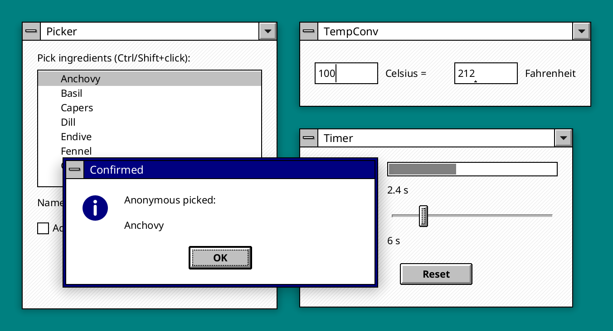

Saudade exists to make GUI programs that look like they fell out of 1992 while
staying portable, density-independent, and crisp on modern displays.

Applications built with Saudade pair exceptionally well with my Wayland
window manager [Canoe](https://github.com/roblillack/canoe), but are just as
much at home on Windows, macOS, and any other Wayland or X11 desktop.

These are some apps using Saudade: [Git Journey](https://github.com/roblillack/gitj), [retrocalc](https://github.com/roblillack/retrocalc), [retrofetch](https://github.com/roblillack/retrofetch), and [RetroSaurus](https://github.com/roblillack/RetroSaurus)

## Status

Pre-1.0, intentionally small. The widget set covers what most desktop
applications are made of, on all four backends, and CI builds and tests every
change on Linux, macOS, and Windows. One app still has one main window (see
"Roadmap"), with its dialogs and popups as windows of their own. The API is
documented on [docs.rs](https://docs.rs/saudade); this huge ~~braindump~~
README is the rest of the documentation.

Reference apps live under `examples/`. Run any of them with
`cargo run --example <name>`:

| Example         | Screenshot                                                                                 | What it shows                                                                                                                                                                                                                                                                                                                                                                                                                                                                                                                                                                                                                                            |
| --------------- | ------------------------------------------------------------------------------------------ | -------------------------------------------------------------------------------------------------------------------------------------------------------------------------------------------------------------------------------------------------------------------------------------------------------------------------------------------------------------------------------------------------------------------------------------------------------------------------------------------------------------------------------------------------------------------------------------------------------------------------------------------------------- |
| `notepad`       | 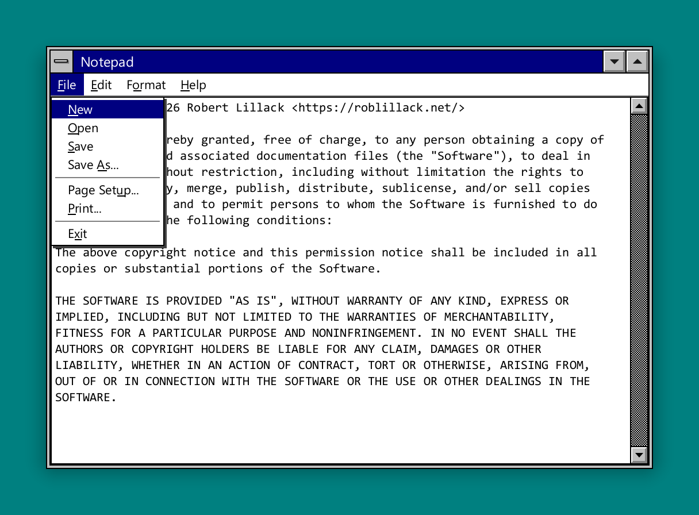             | Editor window with menu bar (`MenuBar`, `TextEditor`); File → Open / Save As drive a `FileDialog`. Also the one example that names a `WindowConfig::icon`, so it shows the desktop's own icon slot filled.                                                                                                                                                                                                                                                                                                                                                                                                                                               |
| `filer`         | 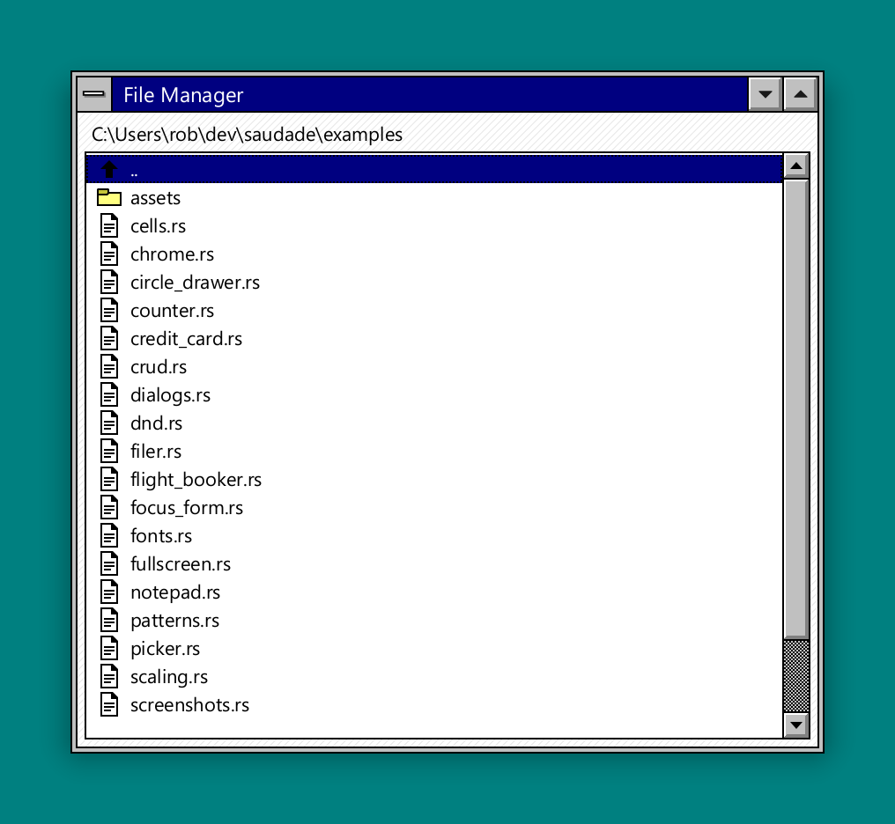                 | Filesystem browser using `List` with folder/file icons. Drag an entry out of the window to drop it onto another app (drag _source_ via `EventCtx::start_drag`; Wayland only).                                                                                                                                                                                                                                                                                                                                                                                                                                                                            |
| `dnd`           | 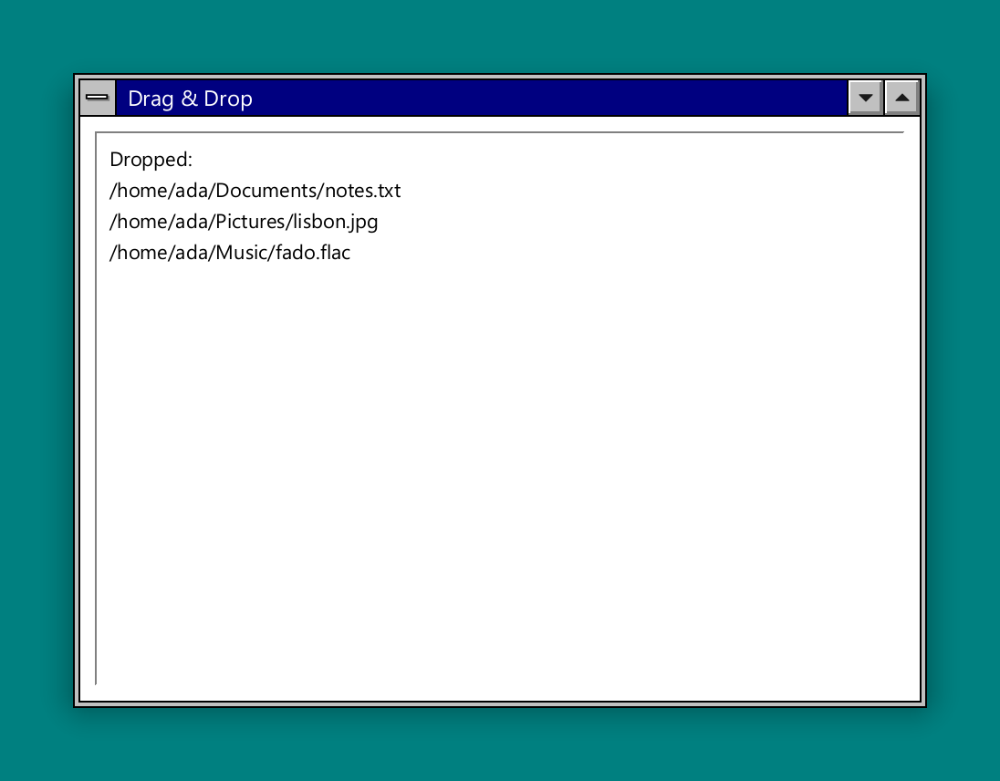                     | A drop zone that highlights while a file drag hovers and lists the paths dropped onto it. Demonstrates OS file drag-and-drop (`DragEnter` / `DragMove` / `DragLeave` / `Drop`) across macOS, Windows, X11, and Wayland.                                                                                                                                                                                                                                                                                                                                                                                                                                  |
| `fullscreen`    | 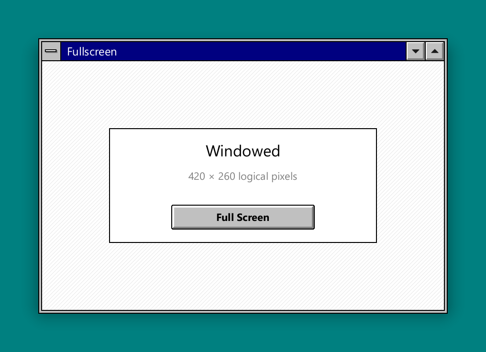       | Toggles the window in and out of fullscreen with a button, F, and Escape (`EventCtx::toggle_fullscreen` / `set_fullscreen`), showing the state `EventCtx::is_fullscreen` reports and the size the layout receives. Run it with `-- --fullscreen` to open fullscreen (`WindowConfig::fullscreen`).                                                                                                                                                                                                                                                                                                                                                        |
| `picker`        | 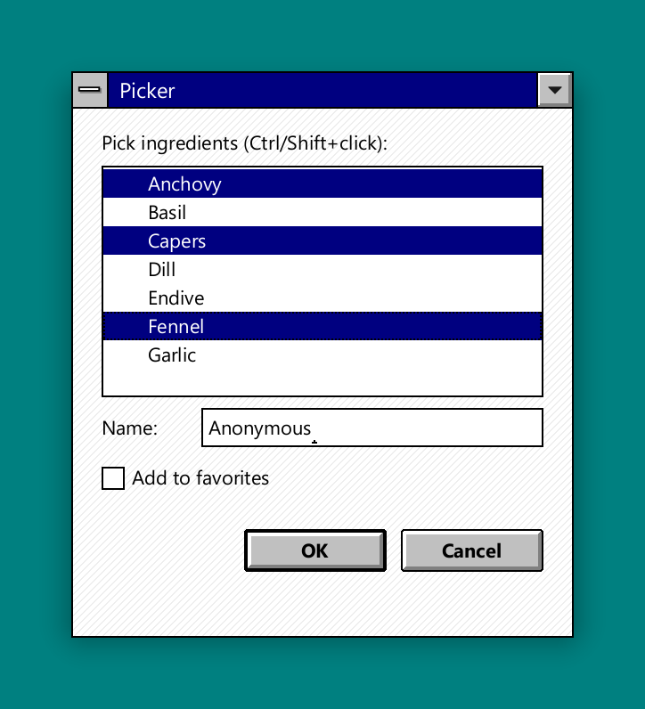               | Pick-an-item dialog: `List` + buttons + `Dialog`, with Tab/Shift+Tab focus cycling.                                                                                                                                                                                                                                                                                                                                                                                                                                                                                                                                                                      |
| `dialogs`       | 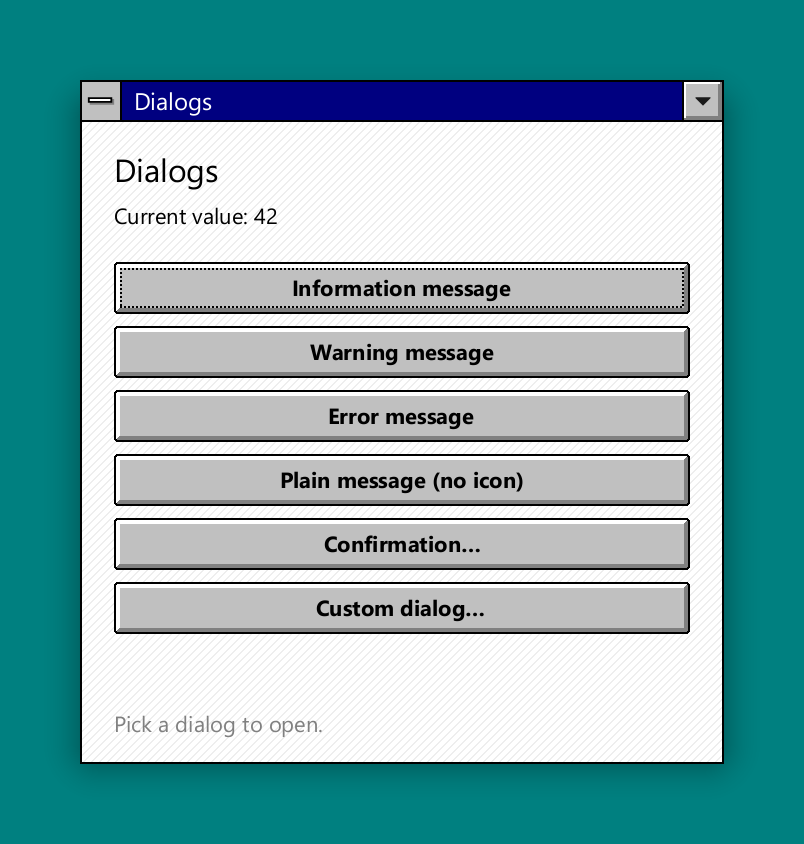             | A launcher with one button per kind of dialog: message boxes (`Dialog::show_info` / `show_warning` / `show_error`, and `show` without an icon), a confirmation box (`Dialog::show_confirm`), and a custom `Modal` around an ordinary `Container` whose `Slider` previews its value in the launcher while open, commits on OK, and reverts on Cancel, Escape or the close button (`Widget::on_cancel`).                                                                                                                                                                                                                                                   |
| `focus_form`    | 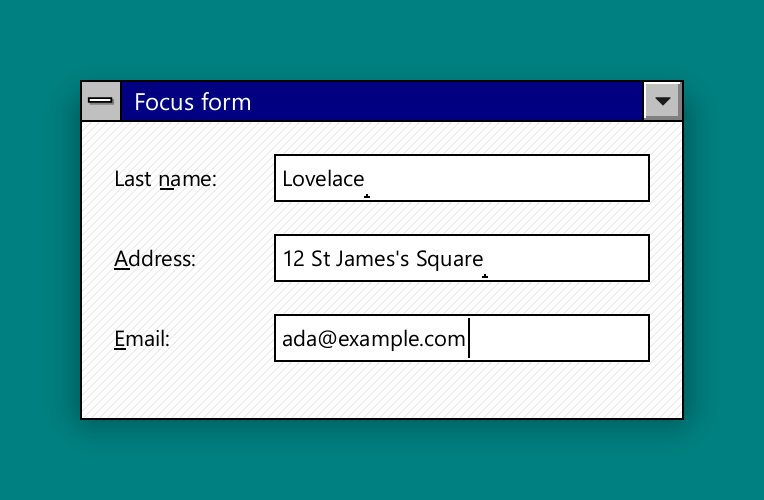       | `FocusLabel` buddy labels: Alt+letter mnemonics jump focus to the next field.                                                                                                                                                                                                                                                                                                                                                                                                                                                                                                                                                                            |
| `page_layout`   | 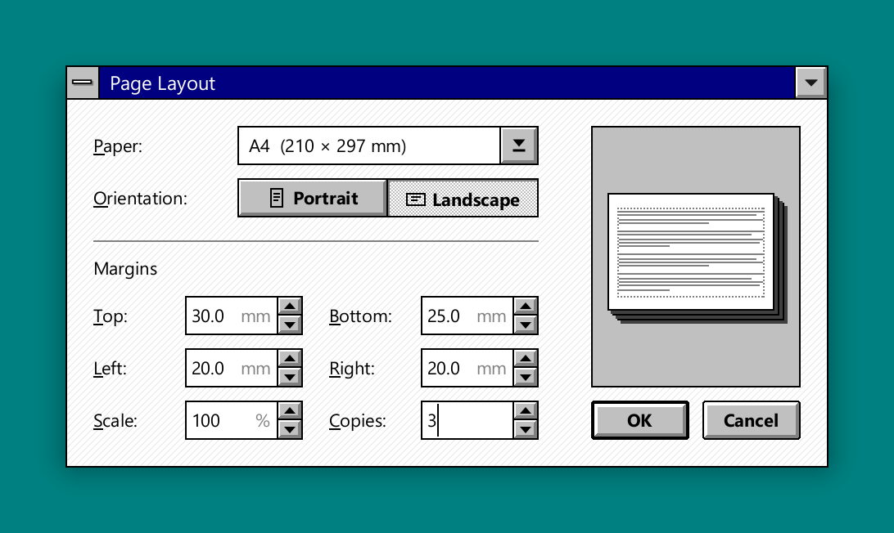     | A page layout dialog with a live preview of the page: a `Dropdown` for the paper size, a `ButtonGroup` of two buttons with an icon and a label each for the orientation, and `NumberInput`s for the margins (millimetres to one decimal, in half-millimetre steps), the scale and the number of copies, each limited to a range of its own.                                                                                                                                                                                                                                                                                                              |
| `counter`       | 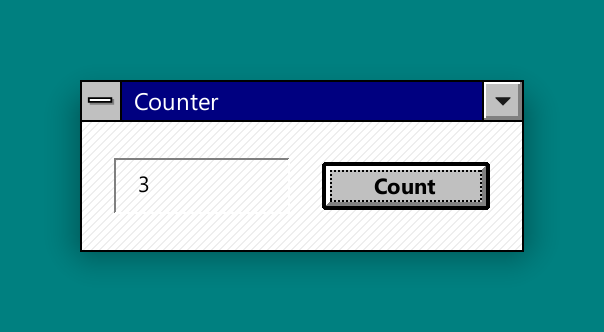             | [7GUIs](https://eugenkiss.github.io/7guis/) task 1 — a `Label` field and a `Button`.                                                                                                                                                                                                                                                                                                                                                                                                                                                                                                                                                                     |
| `temperature`   | 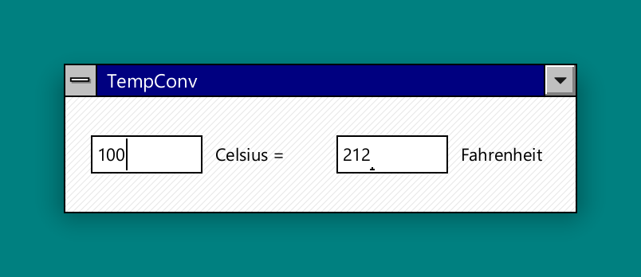     | 7GUIs task 2 — two `TextInput`s converting Celsius ↔ Fahrenheit live.                                                                                                                                                                                                                                                                                                                                                                                                                                                                                                                                                                                    |
| `flight_booker` | 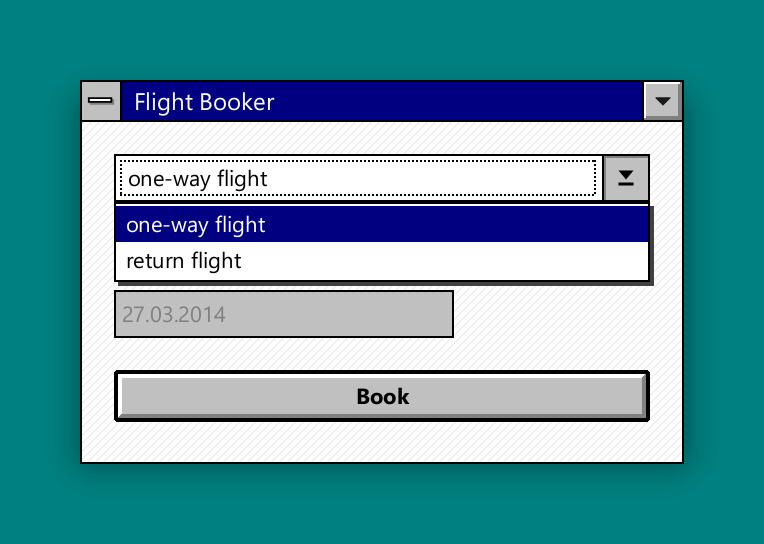 | 7GUIs task 3 — a `Dropdown` picks the flight type and reactively enables / disables the return-date field and the Book `Button`.                                                                                                                                                                                                                                                                                                                                                                                                                                                                                                                         |
| `timer`         | 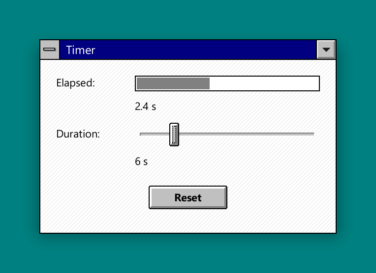                 | 7GUIs task 4 — a `ProgressBar` gauge, a duration `Slider`, and a reset `Button`.                                                                                                                                                                                                                                                                                                                                                                                                                                                                                                                                                                         |
| `crud`          | 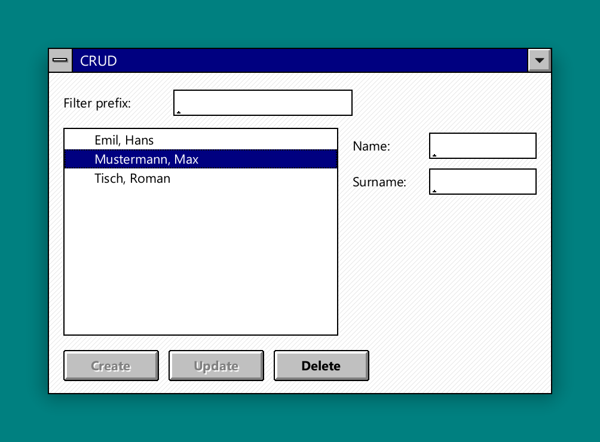                   | 7GUIs task 5 — a `List` as a live, prefix-filtered database view with Create / Update / Delete `Button`s that enable themselves reactively.                                                                                                                                                                                                                                                                                                                                                                                                                                                                                                              |
| `circle_drawer` | 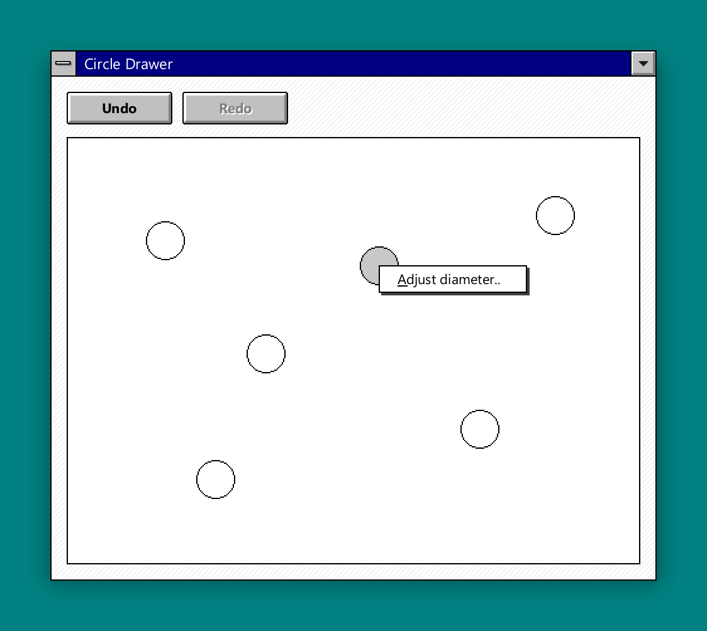 | 7GUIs task 6 — a custom canvas (no circle primitive: midpoint outlines, span-filled disks) with hover selection, a `ContextMenu` right-click menu, a real modal dialog (`Modal`) hosting the diameter `Slider`, and snapshot undo/redo.                                                                                                                                                                                                                                                                                                                                                                                                                  |
| `cells`         | 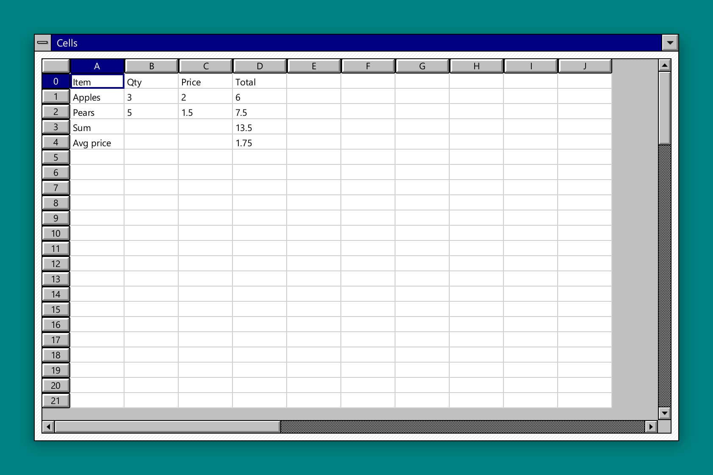                 | 7GUIs task 7 — a scrollable A–Z / 0–99 spreadsheet `Grid` (built on `ScrollBar` + `TextInput`) with a formula engine: cell refs, `+ - * /`, ranges, `SUM`/`AVG`/…, reactive recompute and cycle detection.                                                                                                                                                                                                                                                                                                                                                                                                                                               |
| `patterns`      | 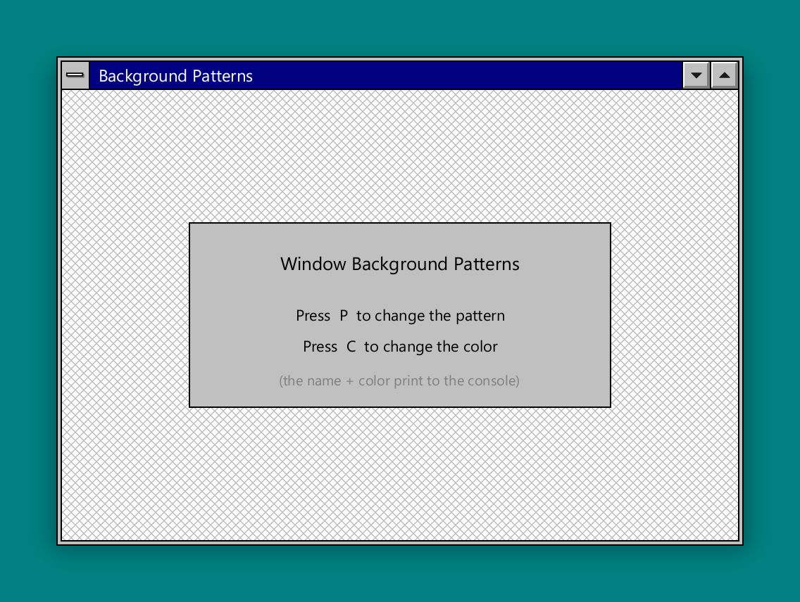           | Previews the window background patterns (`none`, `solid`, `dots`, `lines`, `diagonal`, `cross-stitch`): press `p` to cycle the pattern and `c` to cycle the color. Every app draws one behind its widgets — default `superlight` `diagonal`, overridable with `SAUDADE_WINDOW_PATTERN` / `SAUDADE_WINDOW_PATTERN_COLOR` (e.g. `SAUDADE_WINDOW_PATTERN=dots SAUDADE_WINDOW_PATTERN_COLOR=light`).                                                                                                                                                                                                                                                         |
| `fonts`         | 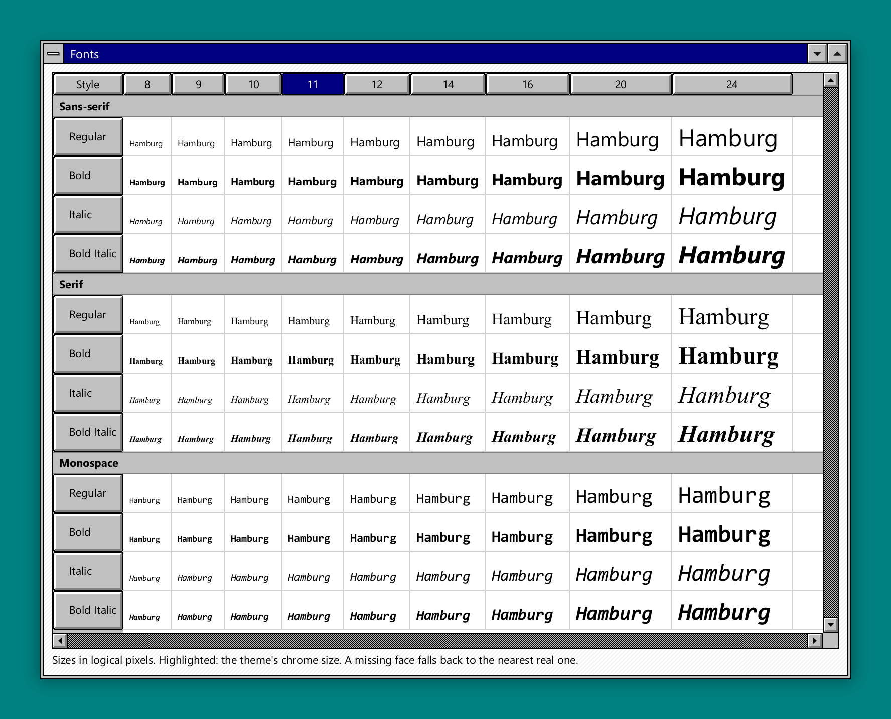                 | A type specimen: all twelve faces — sans / serif / monospace, each in regular, bold, italic and bold-italic — drawn at nine sizes in one large scrolling table (`Painter::text_styled`, columns sized from `measure_text_styled`, size header and style column frozen). The column matching `Theme::font_size` is highlighted; a family the host has no font for says so in place of its four rows.                                                                                                                                                                                                                                                      |
| `scaling`       | 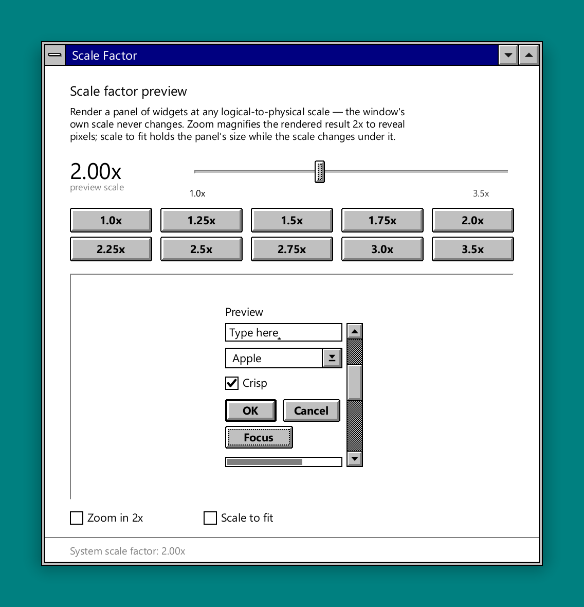             | Previews widgets at an arbitrary logical→physical scale via `Painter::draw_scaled`: a `Slider` and two rows of preset `Button`s walking a quarter ladder up to 3.5x drive a "preview scale" — starting at the display's OS scale — that a small panel of real widgets (`TextInput`, `NumberInput`, `Dropdown`, `ButtonGroup`, `Checkbox`, `Button`s including a focused one for its dotted focus rectangle, `ProgressBar`) redraws at, plus a "zoom in 2x" `Checkbox` that magnifies the result. The window resizes itself (via `EventCtx::request_window_size`) to fit the preview at the chosen scale. The window's own scale is never touched.        |
| `credit_card`   | 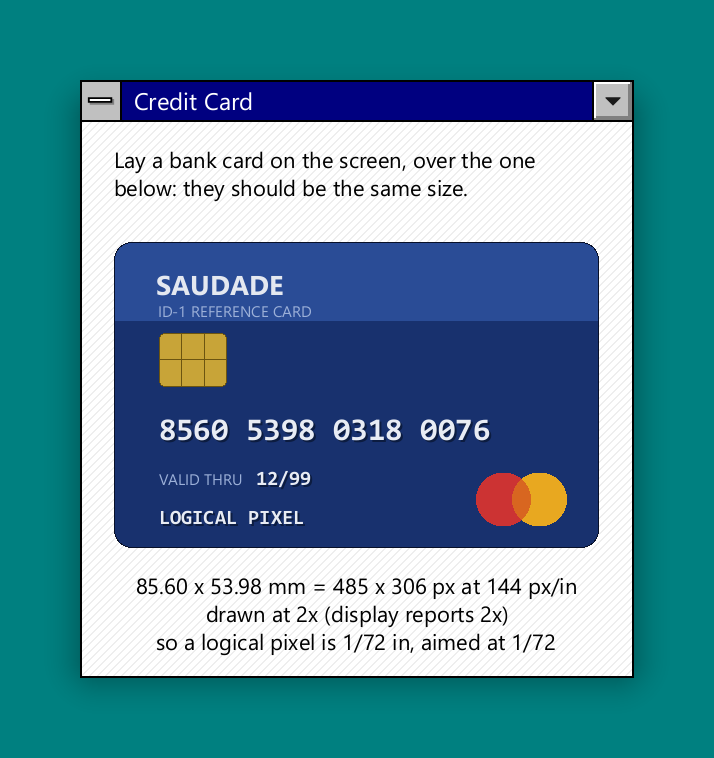     | Draws an ISO/IEC 7810 bank card (85.60 × 53.98 mm) at its real size, whatever scaling the display is set to: the card is painted in device pixels from `Painter::display_dpi`, while the window around it follows the scale factor. A readout compares how big a logical pixel came out on this display with the 1/72 in it aims for. Where the display reports no physical size (a projector, a virtual output) the card falls back to 72 logical pixels to the inch; X11 reports one through RandR and Wayland off `wl_output`, and under fractional scaling the density is the oversampled buffer's rather than the panel's, which is the figure the card has to be counted in.                                                                                                                                                                                                    |
| `svg`           | 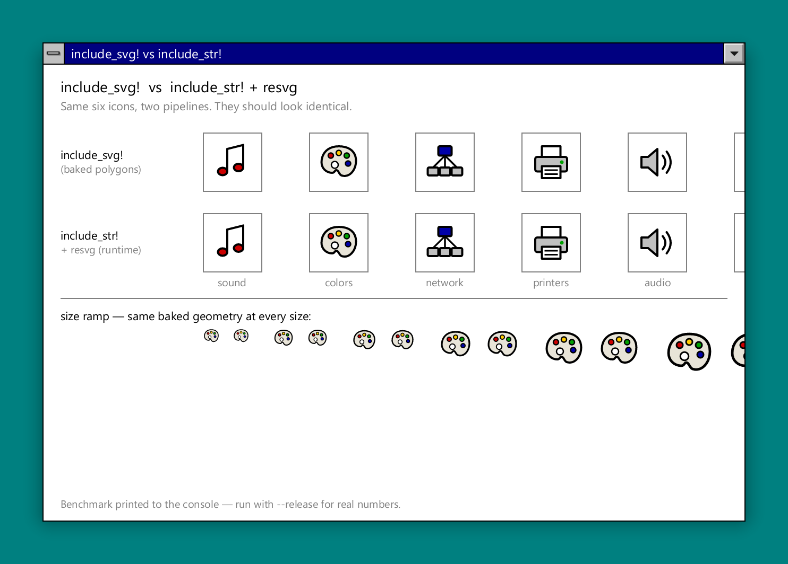                     | Compares `include_svg!` (SVG baked to polygons at compile time, filled at runtime — no SVG crate in the binary) against `include_str!` + `resvg` (parse + rasterize at runtime). Draws six icons both ways for a side-by-side fidelity check and prints a micro-benchmark to the console (run with `--release`). Needs `resvg` only as a dev-dependency, for the comparison.                                                                                                                                                                                                                                                                             |
| `chrome`        | 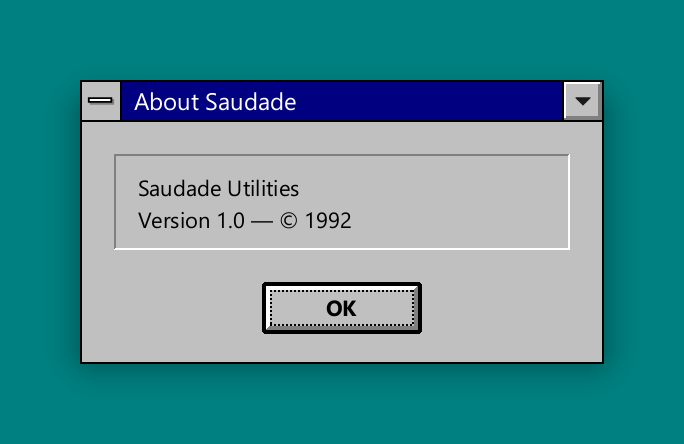               | Renders an "about box" offscreen and wraps it in Canoe-style window chrome (title bar, frame, drop shadow on a teal desktop) via `MockBackend::render_framed`, writing one PNG per frame style (`Resizable` / `Fixed` / `Dialog`). Opens no window — it generates screenshots.                                                                                                                                                                                                                                                                                                                                                                           |

```console
$ cargo run --example notepad        # or: filer, dnd, fullscreen, picker, dialogs,
                                     #     focus_form, page_layout, counter,
                                     #     temperature, flight_booker, timer, crud,
                                     #     circle_drawer, cells, patterns, fonts,
                                     #     scaling, credit_card, svg
```

The screenshots, the one at the top included, come from
[`examples/screenshots.rs`](examples/screenshots.rs), which builds each
example's own window offscreen with `MockBackend`, stages it with a few
synthetic events, and frames it in window chrome with `render_framed` (or
arranges several on a `Desktop`). Refresh them with
`cargo run --example screenshots`.

Saudade was extracted from
[_retrofetch_](https://github.com/roblillack/retrofetch), whose about-box
dialog (`Container` + `Label` + `Button` + `Image` + `Bevel`) was the
original demo; that project now lives in its own repository.

## At a glance

```rust
use saudade::*;

fn main() {
    let root = Container::new(220, 100)
        .with_background(Color::WHITE)
        .with_border(Color::BLACK)
        .add(Label::new(Rect::new(20, 20, 180, 16), "Hello, saudade!"))
        .add(
            Button::new(Rect::new(70, 60, 80, 24), "OK")
                .default(true)
                .on_click(|cx| cx.close()),
        );

    App::new(WindowConfig::new("Hello", 220, 100), root).run();
}
```

## Adding Saudade to your project

Saudade is on [crates.io](https://crates.io/crates/saudade); add it the
usual way:

```console
$ cargo add saudade
```

or list it directly in your `Cargo.toml`:

```toml
# Cargo.toml
[dependencies]
saudade = "0.7.0"
```

Saudade needs Rust 1.88 or newer. On macOS and Windows that is all it needs.
On Linux and the BSDs, building also needs the Wayland and xkbcommon
development files (on Debian/Ubuntu: `libwayland-dev libxkbcommon-dev
pkg-config`); X11 is loaded at run time, so it needs no headers.

The reference apps under `examples/` are plain Cargo examples built against
this crate; see those for a working setup, and run them with
`cargo run --example <name>`.

## Design philosophy

Saudade follows a small set of architectural principles:

- widgets are ordinary Rust values implementing the `Widget` trait
- events are typed Rust enums — no integer message IDs
- widgets request repaint / window-close / focus via a small `EventCtx`
- the runtime drives `winit` and writes pixels through `softbuffer`
- widgets paint in **logical pixels**; the library handles DPI

The mental model is closer to "a typed, ownership-safe GUI runtime" than
to an object-oriented UI framework.

## Module map

| Module     | Contents                                                                                                                                                                                                                                                                                                    |
| ---------- | ----------------------------------------------------------------------------------------------------------------------------------------------------------------------------------------------------------------------------------------------------------------------------------------------------------- |
| geometry   | `Point`, `Size`, `Rect`, `Color`                                                                                                                                                                                                                                                                            |
| event      | `Event`, `DragData`, `MouseButton`, `Key`, `NamedKey`, `Modifiers`, `Cursor`, `EventCtx`                                                                                                                                                                                                                    |
| accel      | `Accel`, `ModifierScheme` — menu shortcuts that read ⌘ on macOS and Ctrl elsewhere                                                                                                                                                                                                                          |
| theme      | `Theme`, default `Theme::windows_31()` palette                                                                                                                                                                                                                                                              |
| background | `BackgroundPattern` — the pattern every window draws behind its widgets                                                                                                                                                                                                                                     |
| painter    | `Painter` — drawing primitives + Win 3.1 chrome helpers                                                                                                                                                                                                                                                     |
| svg        | `SvgImage`, `SvgPolygon`, `FillRule` + the `include_svg!` macro — compile-time vector icons                                                                                                                                                                                                                 |
| font       | `Font`, `FontSet`, `FontFamily`, `FontStyle` — system font lookup + glyph rasterization                                                                                                                                                                                                                     |
| widget     | `Widget` trait (paint / event / focus / overlay hooks)                                                                                                                                                                                                                                                      |
| widgets    | `Container`, `Column`, `Row`, `Label`, `FocusLabel`, `Button`, `ButtonGroup`, `Checkbox`, `Bevel`, `Image`, `MenuBar`, `Menu`, `MenuItem`, `ContextMenu`, `ScrollBar`, `Slider`, `SpinButton`, `ProgressBar`, `List`, `Dropdown`, `Modal`, `Dialog`, `FileDialog`, `TextInput`, `NumberInput`, `TextEditor` |
| app        | `App`, `WindowConfig` — runtime entry point                                                                                                                                                                                                                                                                 |
| icon       | turns `WindowConfig::icon` into what each platform's title bar, taskbar or dock wants                                                                                                                                                                                                                       |
| mock       | `MockBackend`, `Snapshot`, `Desktop` — offscreen rendering to a pixel buffer / PNG                                                                                                                                                                                                                          |
| chrome     | `WindowChrome`, `WindowFrame` — Canoe-style title bar + frame for screenshots                                                                                                                                                                                                                               |

Everything user-facing is re-exported from the crate root; you generally
just `use saudade::*;`.

## Core types

### `Color`

Packed 32-bit ARGB. Helpers cover the Win 3.1 default palette:

```rust
Color::rgb(0x40, 0x40, 0x40);
Color::argb(0x80, 0x00, 0x00, 0xFF); // half-transparent blue
Color::BLACK;      Color::WHITE;
Color::LIGHT_GRAY; Color::MID_GRAY; Color::DARK_GRAY;
Color::NAVY;       Color::RED;
Color::GREEN;      Color::YELLOW;
Color::TRANSPARENT;
```

`Color::TRANSPARENT` is used by `Image` to mark "skip this pixel".

### `Point`, `Size`, `Rect`

```rust
let p = Point::new(10, 20);
let s = Size::new(60, 24);
let r = Rect::new(10, 20, 60, 24);

assert!(r.contains(Point::new(15, 25)));
assert_eq!(r.right(), 70);
assert_eq!(r.bottom(), 44);
let inset = r.inset(2); // shrinks by 2 px on every side
```

All coordinates are _logical_ pixels (i32). The library multiplies by the
OS-reported scale factor when drawing.

## Events

```rust
pub enum Event {
    PointerMove  { pos: Point },
    PointerDown  { pos: Point, button: MouseButton },
    PointerUp    { pos: Point, button: MouseButton },
    PointerLeave,
    Scroll       { pos: Point, delta_x: f32, delta_y: f32 },
    DragEnter    { pos: Point },              // a file drag entered the window
    DragMove     { pos: Point },              // …and moved (Wayland only)
    DragLeave,                                // …and left without dropping
    Drop         { pos: Point, data: DragData }, // files were dropped
    KeyDown      { key: Key, modifiers: Modifiers },
    KeyUp        { key: Key, modifiers: Modifiers },
    Char         { ch: char, modifiers: Modifiers },
    Tick,        // ~60 Hz while any widget wants_ticks()
}

pub struct DragData { pub paths: Vec<PathBuf> }

pub enum MouseButton { Left, Right, Middle }

pub enum Key {
    Named(NamedKey),  // editing / navigation / function keys
    Char(char),       // physical key as a logical character
}

pub enum NamedKey {
    Enter, Backspace, Delete, Tab, Escape, Space,
    Left, Right, Up, Down, Home, End, PageUp, PageDown,
    F1, F2, /* … */ F24,
}

pub struct Modifiers { pub shift: bool, pub control: bool, pub alt: bool, pub logo: bool }
```

`Event::position()` returns the cursor `Point` for positional events —
including `Scroll` and the positional drag events (`DragEnter`, `DragMove`,
`Drop`), so containers route them to the widget under the pointer — or `None`
for `PointerLeave`, `DragLeave`, and keyboard events.
`Event::is_keyboard()` distinguishes the three keyboard variants.

`Event` is `Clone` but not `Copy`: `Drop` owns a `DragData` (a `Vec` of paths).
Dispatch always passes `&Event`, so this costs nothing on the hot path — only a
widget that keeps a dropped payload pays for the clone.

`Scroll` carries the wheel / trackpad movement in document _lines_, positive
toward the content's end (`delta_y` down, `delta_x` right). One wheel notch is
three lines; trackpad pixel deltas become a fractional line count, which the
backends normalize so both kinds of scroll feed widgets the same units.
`ScrollBar`, `List`, and `TextEditor` all honor it; the latter two scroll
whenever the pointer is anywhere over the field, leaving the selection and
caret untouched.

`KeyDown` / `KeyUp` are for _keys_ — useful for Backspace, arrows, function
keys, and modifier-bearing shortcuts. `Char` is for _text input_ — what the
keyboard layout decided the user typed. The runtime suppresses `Char`
when a command modifier (Ctrl / Alt / Logo) is held so editors don't
ingest "\x01" for Ctrl+A; the matching `KeyDown` still fires.

`Modifiers::has_command()` is true if any of Ctrl / Alt / Logo is held.

### Drag and drop

Saudade receives **file drops from the OS** on every backend — drag files from
Finder / Explorer / your file manager onto a window and the runtime turns the
drag into the same typed events everything else uses:

| Event       | When                                           | Carries            |
| ----------- | ---------------------------------------------- | ------------------ |
| `DragEnter` | a file drag entered the window                 | `pos`              |
| `DragMove`  | the drag moved (Wayland only)                  | `pos`              |
| `DragLeave` | the drag left / was cancelled without dropping | —                  |
| `Drop`      | the files were released                        | `pos` + `DragData` |

A widget opts in by matching these in its `event` handler — there's no separate
trait method. `DragEnter` / `DragMove` / `Drop` carry a `pos` and route to the
widget under the cursor exactly like pointer events; `DragLeave` carries no
position and is broadcast to every widget (like `PointerLeave`), so any drop
target can clear a highlight. A drop target **must call `ctx.accept_drop()`**
while handling `DragEnter` / `DragMove` to declare it will take a drop there;
without it the runtime treats the widget as uninterested and the drag falls
through. That's also what tells the _source_ app the spot is a valid target —
its drag cursor reflects it — so windows with no drop zone correctly read as
"no drop". A typical drop target accepts + highlights on `DragEnter`,
un-highlights on `DragLeave`, and consumes `data.paths` on `Drop`:

```rust
fn event(&mut self, event: &Event, ctx: &mut EventCtx) {
    match event {
        Event::DragEnter { .. } | Event::DragMove { .. } => {
            ctx.accept_drop();           // <- required to receive the drop
            self.hot = true;
            ctx.request_paint();
        }
        Event::DragLeave => { self.hot = false; ctx.request_paint(); }
        Event::Drop { data, .. } => { self.open_files(&data.paths); ctx.request_paint(); }
        _ => {}
    }
}
```

(On Wayland `accept_drop` accepts the drag offer per position; on the winit
backends the OS has already committed to the drop, so it's advisory there but
keeps drop targets portable.)

The **payload only arrives with `Drop`**, never with `DragEnter` / `DragMove`:
the platforms only let us read a drag's contents reliably once the user actually
drops (reading mid-hover can block on a source that withholds the data), so the
enter/move events are a presence-and-position signal and `Drop` delivers the
files.

Two per-backend caveats:

- **Position.** On Wayland the drag position is exact and `DragMove` tracks the
  pointer continuously, so per-widget routing during a drag works. On the winit
  backends (macOS, Windows, X11) winit reports no cursor position during a file
  drag — `DragEnter` / `Drop` use the last in-window pointer location and there
  is no `DragMove`, so treat the whole window as one drop zone there.
- **Paths only, copy only.** A drop currently resolves to local file paths
  (`text/uri-list` on Wayland; winit's `HoveredFile` / `DroppedFile`
  elsewhere). On Wayland we always accept the _copy_ action, never move, so a
  drop never makes the source delete the user's file.

See `examples/dnd.rs` (`cargo run --example dnd`) for a working drop zone.

#### Dragging files out (Wayland only)

A widget can also be a drag **source** — start an OS drag carrying file paths so
another application can receive it — by calling `EventCtx::start_drag` once it
recognizes a press-then-move gesture:

```rust
fn event(&mut self, event: &Event, ctx: &mut EventCtx) {
    match event {
        Event::PointerDown { pos, button: MouseButton::Left } => self.arm(*pos),
        Event::PointerMove { pos } if self.moved_past_threshold(*pos) =>
            ctx.start_drag(DragData::from_paths([self.path.clone()])),
        Event::PointerUp { .. } => self.disarm(),
        _ => {}
    }
}
```

This is **Wayland-only**: winit exposes no API to _initiate_ a drag on any of
its platforms (macOS, Windows, X11), so `start_drag` is a no-op there. The drag
offers `text/uri-list` and copies (never moves) the files. Receiving drops, by
contrast, works on every backend. See `examples/filer.rs` (`cargo run --example
filer`) — drag an entry out of the window onto another app.

### `EventCtx`

Inside an event handler, widgets receive a mutable `&mut EventCtx` and
can ask the runtime to do things:

```rust
pub struct EventCtx { /* opaque */ }

impl EventCtx {
    pub fn request_paint(&mut self);             // mark window dirty
    pub fn close(&mut self);                     // close the window after dispatch
    pub fn request_focus(&mut self);             // become the keyboard target
    pub fn release_focus(&mut self);             // drop keyboard focus
    pub fn request_window_size(&mut self, w: i32, h: i32); // resize the window
    pub fn set_fullscreen(&mut self, on: bool);  // fill the display, or not
    pub fn toggle_fullscreen(&mut self);
    pub fn is_fullscreen(&self) -> bool;
    pub fn set_cursor(&mut self, cursor: Cursor); // pointer shape, on PointerMove
}
```

Widgets never poke at the runtime directly. The runtime collects the
requests after a dispatch completes and applies them all at once, which
keeps event handling deterministic and re-entrancy-free.

#### Fullscreen

`set_fullscreen(true)` makes the main window fill the display it is on —
borderless, over the title bar and the taskbar, menu bar or panels — and
`set_fullscreen(false)` puts it back where it was, at the size it had.
`toggle_fullscreen()` is the View → Full Screen command in one call. The new
size reaches the widget tree through `layout` like any resize, so a `Column`
root reflows to fill the display and a fixed-size `Container` root sits centered
on the window background.

```rust
MenuItem::action("&Full Screen", |cx| cx.toggle_fullscreen())
```

The user can also leave fullscreen without the app (macOS's green button, a
compositor keybinding), so ask `is_fullscreen()` for the current state rather
than remembering the last request. Within the dispatch that asked for a switch,
it already answers with the state being switched to. While the window is
fullscreen, `request_window_size` is held and applied when it leaves.

On Windows and X11 the window switches in place; on macOS it moves into a
fullscreen space of its own, with the system animation; on Wayland the
compositor sizes it to the output and saudade restores the windowed size
afterwards.

On Windows, a fullscreen window the user moves to another display with
Win+Shift+Left / Right fills that display, whatever its size and density, and
leaving fullscreen brings it back as a window on the display it is on now: at
the size it had, scaled for that display, and maximized again if it was. (On X11
and Wayland, keeping a fullscreen window covering the display it is moved to is
the window manager's or compositor's job, and the new size arrives through
`layout` as usual.)

`WindowConfig::fullscreen(true)` opens a window fullscreen to begin
with, and `MockBackend` honors requests on the spot (`is_fullscreen()`,
`with_fullscreen()`, and `DispatchOutcome::fullscreen_request`), so they can be
tested offscreen.

#### Mouse cursor

`set_cursor` picks the pointer's shape while it is over the widget:

```rust
fn event(&mut self, event: &Event, ctx: &mut EventCtx) {
    if let Event::PointerMove { pos } = event
        && self.splitter_rect().contains(*pos)
    {
        ctx.set_cursor(Cursor::ColResize);
    }
}
```

Only `PointerMove` counts. After each move the runtime shows whatever
cursor a widget asked for while handling it, and the arrow if none did,
so a widget asks again on every move it wants a cursor for and has
nothing to reset when the pointer leaves; a request made while handling
a press, a key, or a tick is ignored. Of the built-in widgets, only the
text fields ask for one (`Cursor::Text`); buttons and the rest keep the
arrow, as they did in Windows 3.1. `Cursor` covers the
CSS / freedesktop set of shapes — resize arrows, grab hands, crosshair,
wait, and the rest — and each maps to the platform's own: a
`wp_cursor_shape` request on Wayland, a winit `CursorIcon` everywhere
else.

## Theme

```rust
pub struct Theme {
    pub background: Color,      // window / workspace fill
    pub face: Color,            // button / menu-bar face
    pub highlight: Color,       // light bevel edge
    pub shadow: Color,          // dark bevel edge
    pub border: Color,          // 1-px outer black border
    pub text: Color,
    pub disabled_text: Color,
    pub highlight_bg: Color,    // selected-item bg (Win 3.1: navy)
    pub highlight_text: Color,  // selected-item fg (Win 3.1: white)
    pub font_size: f32,         // all chrome text
    pub button_style: FontStyle, // face a push button's label is set in
}
```

The default is `Theme::windows_31()`: white workspace, light-gray button
face, white top/left highlight, mid-gray bottom/right shadow, black outer
border, navy/white selection, 11pt text. Pass an alternative via
`App::with_theme(...)` if you want to skin the same widgets differently.

`button_style` is the face a push button sets its label in. It defaults to
`FontStyle::Bold` — a button is the one thing on a panel you press, and the
weight says so at a glance — and `FontStyle::Regular` gives a lighter look.
It is a button knob and nothing more: menus, captions, fields, list rows and
dialog text stay regular either way. A family the host ships no real bold for
falls back to its own regular face rather than to a synthesized one, and the
label is measured in whichever face it is drawn in, so a wider one still
centers on the button.

## Built-in widgets

All widgets implement `Widget` and own their own state. Coordinates are
always in logical pixels.

### Layout vs. absolute positioning

Saudade ships with two top-level container styles:

- **`Container`** — children are placed at absolute logical-pixel positions.
  This is what you want for _dialogs_ (about boxes, simple alerts) that
  have a fixed design size and shouldn't reflow. If the OS gives the
  window a larger buffer than the design, the runtime centers the
  Container and fills the surroundings with `theme.background`.
- **`Column`** — children are stacked top-to-bottom and _flex_ with the
  window. Each child is either `add_fixed(widget, height)` (takes a
  declared height) or `add_fill(widget)` (shares whatever space is left
  over). On every window resize, the runtime calls `layout` on the root
  widget; `Column` propagates that to its children, so a menu bar stays
  pinned to the top and a text editor below it grows with the window.

Widgets opt into layout by overriding `Widget::layout(&mut self, bounds:
Rect)`. Most box-shaped widgets do — `MenuBar`, `TextEditor`, `List`,
`ScrollBar`, `Row`, `Button`, `Checkbox` and `Label` all store the new rect
(and rebuild any cached geometry), so they reflow inside a `Column`/`Row` or
any container that propagates `layout`. Widgets that don't override `layout`
(e.g. `Bevel`, `Image`) keep the position they were given at construction —
which is exactly what `Container`'s children want.

```rust
// Notepad layout: menu bar pinned to the top, editor fills the rest.
// The runtime auto-focuses the first focusable widget (the editor) at
// startup, so the user can type immediately.
let root = Column::new()
    .with_background(Color::WHITE)
    .add_fixed(menu_bar, MENU_BAR_H)
    .add_fill(text_editor);
```

`Column` also handles capture, focus, accelerator routing, and the
overlay pass — same contract as `Container`.

- **`Row`** — the horizontal sibling of `Column`. Same `add_fixed(widget,
width)` / `add_fill(widget)` API, laying children left-to-right across the
  full height, with the same capture / focus / accelerator / Tab handling.
  Unlike `Column` it carries no overlay layer — keep modal dialogs on the
  top-level container so there's a single overlay owner.

Both `Column` and `Row` expose `focus_child(index)` to choose a non-default
initial focus target (e.g. focus a content list instead of a leading toolbar
field). Custom container widgets outside the crate can reuse Saudade's focus
protocol via `EventCtx::is_focus_requested` / `is_focus_released` /
`clear_focus_flags`.

### `Container`

A flat collection of widgets at absolute positions. The container handles:

- **hit testing** — pointer events go to the top-most child whose bounds
  contain the cursor;
- **pointer capture** — a child whose `captures_pointer()` returns true
  keeps receiving pointer events until it un-captures (used by `Button`
  and `MenuBar`);
- **keyboard focus** — clicking a focusable child makes it the keyboard
  target; keyboard events route there only;
- **focus cycling** — Tab and Shift+Tab walk forward / backward through
  focusable children, wrapping at either end. The container looks at
  each child's `focusable()` and calls `focus_first` on the new target,
  so wrapper widgets that delegate focus to a nested leaf are handled
  transparently;
- **accelerator routing** — keyboard events also go to any child whose
  `accepts_accelerators()` returns true (used by `MenuBar` to catch
  Alt+letter combos while a sibling holds focus);
- **overlay pass** — every widget's `paint_overlay` runs after every
  widget's regular `paint`, so popups (menus, tooltips) draw on top of
  siblings.

```rust
let root = Container::new(395, 305)        // size in logical pixels
    .with_background(Color::WHITE)         // optional fill
    .with_border(Color::BLACK)             // optional 1-px outer border
    .add(Label::new(Rect::new(20, 20, 120, 16), "Hello"))
    .add(Button::new(Rect::new(150, 50, 80, 24), "OK"));

// imperatively:
let mut root = Container::new(395, 305);
root.push(Label::new(Rect::new(20, 20, 120, 16), "Hello"));
```

The runtime calls `Widget::focus_first` on the root once the window is
ready, so a container that holds a `TextEditor` or `List` will hand it
keyboard focus automatically. Override the trait method to choose a
different initial target.

Add order matters: later widgets paint on top and are hit-tested first.

### `Label`

A box of text. A `Label` always occupies a rectangle; text is laid out from
the box's top-left corner. Inherits color and size from the active `Theme`
unless overridden.

```rust
Label::new(Rect::new(10, 10, 120, 16), "Plain label");
Label::new(Rect::new(10, 30, 120, 14), "Smaller").with_size(8.0);
Label::new(Rect::new(10, 50, 120, 16), "Red").with_color(Color::RED);
```

Text is multi-line and word-wrapped to the box automatically — no wrap
points to specify by hand. Explicit `\n` characters always start a new line,
and any line too wide for the box breaks between words, or after a hyphen or
dash joining two. A single word wider than the box is broken too, after a `/`
or `\` if it has one, so a long path splits between its components. Spaces
inside a line are kept as typed. Lines stack at the font's natural line
height.

```rust
Label::new(Rect::new(10, 10, 200, 60),
    "A longer paragraph that wraps across several lines, plus an\nexplicit break.");
```

Anything that extends past the box — horizontally or vertically — is clipped
to its bounds, so a label never paints outside the rectangle it was given.
Placed in a `Column` or `Row`, a label adopts its slot and wraps/clips to
that; placed at an absolute position in a `Container`, it keeps the
rectangle it was constructed with.

### `FocusLabel`

A single-line caption that carries a keyboard **mnemonic** and moves focus to
the field beside it. Mark the accelerator with `&`, exactly like a menu label:
`"Last &name:"` renders _Last name:_ with the **n** underlined and binds
**Alt+N**. Pressing that combination anywhere in the surrounding container
hands focus to the _next focusable widget added to the same parent_ — the
classic "buddy label" convention — so a caption simply precedes its field:

```rust
Container::new(220, 60)
    .add(FocusLabel::new(Rect::new(8, 8, 80, 24), "Last &name:")) // Alt+N…
    .add(TextInput::new(Rect::new(92, 8, 120, 24)));              // …focuses this
```

The accelerator reaches the label even while a sibling holds focus (it rides
the same `accepts_accelerators()` path as `MenuBar`); the label requests the
move with `EventCtx::request_focus_next`, which `Container`, `Column`, and
`Row` resolve to the first focusable child after it. A `FocusLabel` is never
itself focusable, and a caption with no `&` behaves like a plain (single-line)
`Label`. See the `focus_form` example for a full window.

### `Button`

A classic Win 3.1 push button: raised face by default, sunken while
pressed, optional 1-pixel outer black border for the dialog's default
action.

```rust
Button::new(Rect::new(317, 16, 60, 22), "OK")
    .default(true)
    .on_click(|cx| cx.close());
```

Press behavior matches Windows: pressing inside arms the button,
dragging out un-arms (sunken pops back up), dragging back in re-arms,
releasing inside fires `on_click`, releasing outside cancels.

Buttons are focusable: Tab/Shift+Tab cycle through them and the focused
button draws a dotted focus rectangle inside its bevel. Enter or Space
fires the button while it holds focus.

A button created with `.default(true)` is also the **container's Enter
accelerator**: pressing Enter anywhere inside the same `Container` or
`Column` fires the default button, regardless of which sibling holds
focus. The widget that consumed the event sets `EventCtx::consume_event`
so the focused widget (e.g., a list whose Enter handler would otherwise
activate the selected row) doesn't also react to the same keystroke.

`with_icon` leads the label with an `SvgImage` baked by `include_svg!` (see
"Vector icons"), or shows the icon on its own when the label is empty. The
icon is drawn tinted in the label's color, so it greys out along with the
label on a disabled button — which makes it meant for single-color glyphs:

```rust
const UP: SvgImage = include_svg!("assets/icons/up.svg");

Button::new(Rect::new(8, 8, 80, 24), "Up").with_icon(UP);
Button::new(Rect::new(96, 8, 32, 24), "").with_icon(UP); // icon only
```

### `ButtonGroup`

A row (or column) of buttons joined into one control, of which one is
selected at a time: a radio choice made of push buttons, for a page's
orientation, a paragraph's alignment, a view mode. Each button shows a label,
an icon, or both — a `GroupButton`, or just a `&str` for a label alone:

```rust
const PORTRAIT: SvgImage = include_svg!("examples/assets/icons/portrait.svg");
const LANDSCAPE: SvgImage = include_svg!("examples/assets/icons/landscape.svg");

let orientation = ButtonGroup::horizontal(Rect::new(104, 48, 184, 24))
    .with_buttons([
        GroupButton::new("Portrait").with_icon(PORTRAIT), // icon and label
        GroupButton::new("Landscape").with_icon(LANDSCAPE),
    ])
    .on_change(|cx, index| {
        // fires when the user selects a different button
        cx.request_paint();
    });

let align = ButtonGroup::vertical(Rect::new(8, 8, 80, 70))
    .with_buttons(["Left", "Center", "Right"])      // labels only
    .with_selected(1);
let view = ButtonGroup::horizontal(Rect::new(8, 8, 57, 24))
    .with_buttons([GroupButton::icon(PORTRAIT), GroupButton::icon(LANDSCAPE)]);
```

The buttons share the group's rect evenly, and the borders between them. They
wear the scrollbar arrows' lighter chrome, square-cornered so they join into
one frame, and set their faces like a `Button`'s: in `theme.button_style`, the
icon tinted with the label. The selected button stays pushed in, its face
stippled with white the way a latched toolbar button's is. The first button
starts out selected; `set_selected` picks another without firing `on_change`.

| Input           | Effect                                           |
| --------------- | ------------------------------------------------ |
| click a button  | select it (on release, as a `Button` fires)      |
| ← / ↑ and → / ↓ | select the previous / next button, while focused |
| Home / End      | select the first / last button, while focused    |

The group takes the focus as a whole, drawing the dotted focus rectangle inside
the selected button, so a `FocusLabel` in front of it can jump there.

### `Checkbox`

A Win 3.1 check box: a 13×13 sunken white box, ticked when set, with its
label to the right.

```rust
Checkbox::new(Rect::new(16, 200, 200, 16), "Add to favorites")
    .checked(true)
    .on_toggle(|cx, checked| {
        // fires with the new state
        cx.request_paint();
    });
```

A click or Space toggles it. A press behaves like a `Button`'s: dragging
off the checkbox un-arms it, and releasing outside leaves the state alone.
The checkbox is focusable and draws a dotted focus rectangle around its
label. Read the state with `is_checked()`; `set_checked` changes it
without firing `on_toggle`. In a `Column` or `Row` the checkbox takes its
slot; elsewhere `set_rect` moves it — to keep it anchored to the bottom of
a resizable window, say.

### `Bevel`

Decorative chrome — no events, no state.

```rust
Bevel::etched_line(20, 200, 350);                       // two-tone divider
Bevel::raised(Rect::new(10, 10, 100, 30));              // raised frame
Bevel::sunken(Rect::new(10, 50, 100, 30));              // sunken frame
```

### `Image`

A static ARGB32 pixel buffer at an absolute position. Pixels with
`alpha == 0` are skipped (transparent). Useful for small procedural
glyphs and logos:

```rust
let mut logo = Image::new(0, 0, 40, 28);
logo.fill_rect(Rect::new(2, 2, 16, 10), Color::RED);
logo.fill_rect(Rect::new(20, 4, 16, 10), Color::GREEN);
logo.set_pixel(1, 1, Color::BLACK);
```

Use `Image::from_pixels(x, y, w, h, pixels)` to attach an externally
decoded raster (PNG/BMP/etc.) as ARGB32.

### `MenuBar`, `Menu`, `MenuItem`

A classic Win 3.1 menu bar. Top labels live in a white bar (matching
Win 3.1's program-manager chrome); clicking one drops a white popup with
a sharp L-shape drop shadow. The currently-open top-level label and any
hovered popup item are drawn with a navy background and white text. The
popup is rendered in the overlay paint pass so it floats over every
sibling widget.

```rust
let menu_bar = MenuBar::new(Rect::new(0, 0, 520, 20))
    .add_menu(Menu::new(
        "&File",
        vec![
            MenuItem::action("&New",   |cx| { /* … */ cx.request_paint(); }),
            MenuItem::action("&Open",  |_| { /* … */ }),
            MenuItem::action("&Save",  |_| { /* … */ }),
            MenuItem::separator(),
            MenuItem::action("E&xit",  |cx| cx.close()),
        ],
    ))
    .add_menu(Menu::new("&Help", vec![
        MenuItem::action("&About", |_| {}),
    ]));
```

**Mnemonics.** Labels may include `&` immediately before a character to
declare the mnemonic. `"&File"` displays as `File` with **F** underlined;
press `Alt+F` (closed bar) or just `F` (open menu) to fire it. Use `&&`
to render a literal `&`. Mnemonics route through the
`accepts_accelerators` hook on the menu bar, so they keep working even
while a `TextEditor` holds keyboard focus.

**Shortcuts.** `MenuItem::with_accel` gives an item a keyboard shortcut,
shown right-aligned in its menu and live whenever the bar is closed:
pressing the chord fires the item without opening the menu, and the
keystroke goes no further. A chord names modifier _roles_ rather than
keys, so one declaration does the native thing on every platform:

```rust
MenuItem::action("&Open…", |_| { /* … */ }).with_accel(Accel::primary('o'));
MenuItem::action("&Reload", |_| { /* … */ }).with_accel("Ctrl+Shift+R"); // Ctrl or Cmd: primary
MenuItem::action("Re&fresh", |_| { /* … */ }).with_accel(Accel::new(NamedKey::F5));
```

| Role        | macOS     | Windows, Linux, BSD |
| ----------- | --------- | ------------------- |
| `primary`   | ⌘ Command | Ctrl                |
| `secondary` | ⌃ Control | Super (Windows key) |
| `alt`       | ⌥ Option  | Alt                 |
| `shift`     | Shift     | Shift               |

The hint is written the platform's way too: "Shift+Cmd+R" on a Mac,
"Ctrl+Shift+R" elsewhere. Modifiers must match exactly — Ctrl+R doesn't
fire on Ctrl+Shift+R — and AltGr chords never match, since they type
characters. Keep `secondary` for rare chords that also carry `primary`:
Windows and most Wayland compositors claim many Super chords for
themselves. A chord whose items are all disabled by `with_enabled` goes on
to the focused widget instead. A `ContextMenu` shows the same hints, but
only a menu bar listens for its chords.

**Mouse behavior.** A single click on a top-level label opens the menu;
moving the cursor over items highlights them, and a second click on an
item fires it. **A click that opens the menu without dragging
pre-highlights the first action**, so the user can immediately fire it
with Enter or keep arrow-navigating. The press-drag-release gesture
also works: press on a top-level label, drag down through the popup,
release on an item to fire it without an intermediate click.
Releasing anywhere else just disarms the gesture and leaves the menu
open. Sliding the cursor along the bar with a menu open swaps between
top-level menus. Click outside (or press Esc) to dismiss.

**Keyboard navigation** (active while a menu is open):

| Key        | Effect                                                                    |
| ---------- | ------------------------------------------------------------------------- |
| ↑ / ↓      | move highlight to the previous / next action (skipping separators; wraps) |
| Home / End | jump to first / last action                                               |
| ← / →      | switch to the previous / next top-level menu                              |
| Enter      | fire the currently highlighted action                                     |
| letter     | fire the action whose mnemonic matches                                    |
| Esc        | dismiss the menu                                                          |

Menus opened with Alt+letter (or arrow-switched left/right) always
pre-highlight the **first** action of the newly opened menu — the
previous highlight position never carries over. Click-to-open menus
also pre-highlight the first item if the cursor never reached the
popup before release; only drag-style opens leave nothing hovered.

While a menu is active no keyboard event is forwarded to the focused
widget below — typing in an open menu doesn't leak into the editor.

**Popups live in their own window.** When a menu opens, the runtime
spawns a borderless window for the popup, sized exactly to its
contents and behaving like a native menu on each backend:

- **Windows** (through winit): an owned `WS_POPUP` window that never
  activates. The window it drops from keeps the keyboard and its active
  title bar, and sharing that window in a video call shows the open
  menu too.
- **macOS** (through winit): a child window of the window it drops
  from, which never becomes key. The window server carries it along
  when that window moves, the keyboard stays with that window, and
  ScreenCaptureKit's single-window capture takes it in.
- **X11** (through winit): an _override-redirect_ window with the
  `_NET_WM_WINDOW_TYPE_DROPDOWN_MENU` hint. The WM is bypassed
  entirely, so the popup appears instantly at the requested position
  and size and can extend beyond the main window's edges. The runtime
  also re-anchors it via `Window::set_outer_position` whenever the
  main window emits a `Moved` event, so the popup follows window
  drags.
- **Wayland** (through smithay-client-toolkit): a real `xdg_popup`
  surface created with an `xdg_positioner` anchored to the parent
  surface. The compositor handles placement, follow-on-drag, and
  auto-dismiss (sending `popup_done`, which we translate into a
  synthesized Escape).

The popup is dismissed by clicking outside it (the main window
receives the click and the menu folds up), pressing Escape, or firing
an item — and, like a native menu, by the keyboard moving out of it
altogether: clicking the title bar to drag the window, or switching to
another app. A `Dialog` popup is a window in its own right and is not
dismissed that way.

`MenuBar::open(idx)` programmatically opens a menu — handy for custom
application-level keybindings.

### `ContextMenu`

The same panel a `MenuBar` drops open, anchored at a point instead of
hanging off a bar label — the classic right-click menu. It is built from
the same `MenuItem`s, so mnemonics, accelerator hints, checkmarks,
separators and `with_enabled` predicates all work exactly as they do in
a menu, and it lives in its own borderless window the same way, so it is
never clipped by the widget it belongs to.

```rust
let mut menu = ContextMenu::new().with_items(vec![
    MenuItem::action("&Edit", |_| { /* … */ }),
    MenuItem::action("&Duplicate", |_| { /* … */ }),
    MenuItem::separator(),
    MenuItem::action("De&lete", |cx| { /* … */ cx.request_paint(); }),
]);

// …from the owning widget's `event`, on a right-press:
menu.open_at(pos);
```

**Owning one.** A `ContextMenu` takes no space and is not placed by
layout. Hold it in the widget whose rows it acts on, forward `paint`,
`paint_overlay`, `event` and `collect_popups` to it, and report
`captures_pointer()` while it is open so the pointer keeps reaching it
once it leaves those rows. Added to a `Container` instead, the
container's own routing does all of that for you.

**Items per opening.** A context menu usually acts on whatever was
right-clicked, so build its rows fresh each time: `set_items()` then
`open_at()`. Labels are mnemonic-parsed, so an `&` in a name the app did
not write — a file, a project — has to be doubled
(`label.replace('&', "&&")`) or it disappears and underlines the letter
after it.

**Picking an item** runs its callback, which gets only an `EventCtx` —
nothing that can reach back into the owning widget. Where the action
needs more than the shared application state a closure can capture, have
the callback record what was picked (an `Rc<Cell<…>>`) and act on it
after the event returns.

**Mouse behavior.** Moving the cursor highlights rows; a left-click
fires one and closes the menu. A press outside dismisses it — and a
_right_-press outside is deliberately left unconsumed, so it can open a
fresh menu on whatever it landed on in a single gesture.

**Keyboard navigation** (active while the menu is open):

| Key        | Effect                                                        |
| ---------- | ------------------------------------------------------------- |
| ↑ / ↓      | move highlight (skipping separators and disabled rows; wraps) |
| Home / End | jump to first / last item                                     |
| Enter      | fire the highlighted item                                     |
| letter     | fire the item whose mnemonic matches                          |
| Esc        | dismiss the menu                                              |

As with a menu bar, no keystroke reaches the widget below while the menu
is up.

**Placement.** The panel opens down and to the right of the anchor. The
window it lives in is not the app's, so it may hang off the main
window's edges — which is what a menu right-clicked near a border should
do. What _does_ bound it is the screen (`Painter::screen_area`): the
panel flips to the other side of the anchor rather than crossing an edge
of the display, and a menu taller than the display is capped to it and
scrolls. The wheel and the arrow keys move that window of rows, a click
on either end's arrow pages through it, and the arrows themselves mark
what is off-panel. `open_within(pos, region)` bounds it by a rect of the
caller's choosing instead — a pane it should not leave.

### `ScrollBar`

A Win 3.1 scrollbar: two arrow buttons bracketing a track with a
proportionally-sized thumb. Built standalone — embed it next to any
scrollable view, or let `TextEditor` carry one for you.

```rust
let mut bar = ScrollBar::vertical(Rect::new(380, 20, 16, 280));
bar.set_range(/* viewport */ 20, /* max */ 60);  // 80-row file, 20 visible
bar.set_value(0);
bar.set_line_step(1);
```

Interaction:

| Input       | Effect                                            |
| ----------- | ------------------------------------------------- |
| click arrow | scroll by `line_step` toward the arrow            |
| click track | scroll by `viewport` (one page) toward the click  |
| drag thumb  | scroll proportionally to the drag distance        |
| mouse wheel | scroll three lines per notch along the bar's axis |

The thumb is sized as `track_extent × viewport / (viewport + max)` with a
sane minimum so it stays grabbable even on huge documents. Use
`SCROLLBAR_THICKNESS` (16 logical pixels) to lay siblings out around it.

### `Slider`

A Win 3.1 trackbar: a thin sunken groove with a raised, draggable thumb that
picks an integer value in an inclusive `[min, max]` range. Unlike `ScrollBar`
(which models a _scroll position_ over a viewport), a `Slider` is a plain value
control — use it to dial a number.

```rust
let slider = Slider::new(Rect::new(16, 16, 200, 24), 0, 100)
    .with_value(40)
    .with_step(5)                       // arrow-key increment (default 1)
    .on_change(|cx, value| {
        // fires on every change, including continuously during a drag
        cx.request_paint();
    });

let v: i32 = slider.value();
```

Interaction:

| Input             | Effect                                                |
| ----------------- | ----------------------------------------------------- |
| click / drag      | move the thumb to the cursor (fires `on_change` live) |
| ← / ↓             | decrease by `step`                                    |
| → / ↑             | increase by `step`                                    |
| PageUp / PageDown | jump by a tenth of the range                          |
| Home / End        | snap to `min` / `max`                                 |

The slider is focusable and draws a dotted focus rectangle inside the thumb
when focused. `on_change` fires _during_ a drag, not just on release, so a
gauge or label bound to it updates as the user moves the thumb. Use
`set_on_change` to install the handler after construction (when the slider is
held behind an `Rc<RefCell<…>>`).

### `SpinButton`

A pair of arrow buttons that step something up or down: an up arrow over a down
arrow, or a left arrow beside a right one. It holds no value of its own — it
reports steps and leaves what a step means to its owner: a number, a date, the
next entry of a list. For a number typed into a field, `NumberInput` builds one
in already.

```rust
let paper = SpinButton::vertical(Rect::new(272, 16, 16, 24))
    .on_step(|cx, steps| {
        // +1 for the up / right arrow, -1 for the down / left one
        cx.request_paint();
    });
let orientation = SpinButton::horizontal(Rect::new(256, 48, 32, 24));
```

| Input       | Effect                                              |
| ----------- | --------------------------------------------------- |
| click arrow | one step                                            |
| hold arrow  | repeat the step, at the scrollbar arrows' pace      |
| mouse wheel | one step per notch: up (or a swipe right) counts up |

A quick turn of the wheel can bring several steps in one call, so scale by
`steps` rather than assume ±1. Like `ScrollBar`, it takes no keyboard focus.
To set one flush against a field of your own, as `NumberInput` does, let the
field run two pixels on under the arrows: their border then is the field's right
edge.

### `ProgressBar`

A sunken white field that fills from the left with a solid grey bar in
proportion to its `fraction` (0.0–1.0). The fill is a neutral grey, not the
selection navy used by lists and text fields — a progress bar isn't "focused,"
so it shouldn't borrow that color's meaning. Purely presentational — no events,
no focus, no built-in animation: drive it by calling `set_fraction` from
whatever owns the underlying progress.

```rust
let mut bar = ProgressBar::new(Rect::new(16, 16, 200, 16))
    .with_percentage(true);             // draw the rounded % over the bar
bar.set_fraction(0.6);                  // 60% full
```

With `with_percentage(true)` the bar draws the rounded percentage centered over
the field in the normal text color, which stays legible over both the empty and
filled halves.

### `TextInput`

A single-line text field: the same sunken white field as `TextEditor`,
but set in the proportional UI font, for names, numbers, search terms —
anywhere one line is enough.

```rust
let celsius = TextInput::new(Rect::new(16, 16, 120, 22))
    .with_text("0")
    .on_change(|cx, text| {
        // fires on every edit made in the field, with the new text
        cx.request_paint();
    });

let text: String = celsius.text();
```

`on_change` fires for typing, Backspace / Delete, and cut / paste from the
keyboard, but never for `set_text` — so two fields that update each other
(Celsius ↔ Fahrenheit in the `temperature` example) don't loop. Use
`set_on_change` to wire the handlers once both fields exist. `set_text`
drops any newlines.

Editing works like the editor's, minus the vertical moves:

| Input                | Effect                                            |
| -------------------- | ------------------------------------------------- |
| typing               | inserts the character (replaces selection)        |
| Backspace / Delete   | deletes the previous / next char or the selection |
| ← / →                | move the caret one character                      |
| Ctrl + ← / →         | move the caret one word                           |
| Home / End           | jump to the start / end                           |
| Shift + any move     | extends the selection                             |
| Ctrl + A / C / X / V | select all / copy / cut / paste                   |
| double-click         | select a word                                     |
| triple-click         | select everything                                 |
| drag with left       | extend the selection                              |

Text that doesn't fit scrolls sideways to keep the caret in view. The
field leaves Enter alone, so it reaches the container's default `Button`
— the usual way a dialog's text field submits. Without the focus, a small
wedge at the bottom of the field marks where the caret will be once the
focus comes back. As on `TextEditor`, `cut`, `copy`, `paste`, and
`select_all` are there to call from menu items.

### `NumberInput`

A `TextInput` for a number, with a `SpinButton` pair along its right edge to
step it. The number lies in a range, is shown with a fixed number of decimals —
its precision — and moves by a step. A unit can show inside the field:

```rust
let margin = NumberInput::new(Rect::new(72, 120, 72, 24))
    .with_range(0.0, 50.0)              // inclusive; unlimited by default
    .with_step(0.5)                     // what one arrow click adds (default 1)
    .with_precision(1)                  // decimals shown (default 0) — set it
    .with_value(25.0)                   // before the value, which it rounds
    .with_unit("mm")                    // grey, next to the arrows (default none)
    .on_change(|cx, mm| {
        // fires whenever the user changes the value
        cx.request_paint();
    });

let mm: f64 = margin.value();
```

The field takes only text that reads as such a number, or as the start of one:
digits, a `-` in front if the range reaches below zero, and a decimal point
followed by no more digits than the precision allows. A keystroke or a paste
that would leave anything else is dropped. A comma typed stands in for the
decimal point, since that is what the keypad's decimal key types on many
layouts. The unit is only shown: the number keeps clear of it, but it can't be
typed over or selected, and the value doesn't include it.

Taking the focus selects the whole number — whether by Tab, a `FocusLabel`'s
mnemonic, or a click in the text — so typing replaces it right away; a click in
a field that already has the focus places the caret. Unlike a `TextInput`, the
field shows neither a caret nor a selection while it doesn't have the focus.

The value follows the text as it is typed: whenever the text reads as a number,
the value is that number clamped to the range, and `on_change` fires. Enter, or
leaving the field, rewrites the text to show the value at its precision —
`250` becomes `100` in a field that stops at 100, and a field left empty shows
its value again.

The arrows, keys and wheel move the value from one multiple of the step to the
next: with a step of 0.5, up from 1.3 goes to 1.5 and down to 1.0, and on from
there by 0.5. A step lands on the precision too, so ten steps of 0.1 make
exactly 1.

| Input             | Effect                                               |
| ----------------- | ---------------------------------------------------- |
| click arrow       | step up / down                                       |
| hold arrow        | repeat the step, at the scrollbar arrows' pace       |
| ↑ / ↓             | step up / down                                       |
| PageUp / PageDown | ten steps up / down                                  |
| mouse wheel       | one step per notch, over the arrows or while focused |
| anything else     | edits the text as in a `TextInput`                   |

`on_change` never fires for `set_value`, `set_range`, `set_step` or
`set_precision`, so inputs that update each other don't loop. The value is an
`f64`; with no decimals, cast it to the integer type you need.

### `TextEditor`

A minimal multi-line text editor: sunken white field, monospace text,
vertical cursor, selection, cut/copy/paste against the OS clipboard,
and a built-in vertical scrollbar pinned to the right edge. Only the
visible rows are measured and drawn each paint, so large files stay
cheap. Designed for system-utility editors (Notepad-style); undo and
word wrap come later.

```rust
let mut editor = TextEditor::new(Rect::new(4, 24, 512, 312))
    .with_font_size(11.0)
    .with_text("Hello\nWorld");

let text: String = editor.text();
```

The editor renders with the monospace font loaded by the runtime (see
"Font handling"). The rest of the UI (menu labels, dialog text) keeps
the proportional default — pick whichever family you want per call via
`Painter::text` (sans) vs `Painter::text_styled(.., FontFamily::Mono, ..)`.

Editing operations:

| Input             | Effect                                     |
| ----------------- | ------------------------------------------ |
| typing            | inserts the character (replaces selection) |
| Backspace         | deletes the previous char or the selection |
| Delete            | deletes the next char or the selection     |
| Enter             | splits the line (replacing the selection)  |
| ← / →             | move cursor one character                  |
| ↑ / ↓             | move cursor one line, clamping column      |
| Home / End        | jump to line start / end                   |
| PageUp / PageDown | jump by one viewport                       |
| Shift + any move  | extends the selection                      |
| Ctrl + A          | select all                                 |
| Ctrl + C          | copy selection to the OS clipboard         |
| Ctrl + X          | cut selection to the OS clipboard          |
| Ctrl + V          | paste at the cursor (replaces selection)   |
| left click        | place the cursor                           |
| drag with left    | extend the selection                       |

Selected text renders with `theme.highlight_bg` (navy) behind it and
`theme.highlight_text` (white) on top. Multi-line selections show a
small visual continuation past end-of-line so the band looks unbroken.

Programmatic methods mirror the keyboard shortcuts so menu items can
invoke the same operations:

```rust
editor.cut();
editor.copy();
editor.paste();
editor.select_all();
```

The clipboard handle is lazily initialized via `arboard`; in headless
environments where the OS clipboard isn't reachable, `copy`/`cut`/
`paste` simply become no-ops — editing still works. On Windows and macOS
arboard talks to the native clipboard. On Wayland sessions arboard is
built with the `wayland-data-control` feature so it speaks the native
`wlr-data-control` protocol; clipboard exchange with other Wayland-native
apps works without needing XWayland.

`TextEditor` keeps content as `Vec<String>` (one entry per line) and
tracks `(row, col)` in _characters_, not bytes — multi-byte UTF-8 is
handled correctly. Per-character widths are cached during paint so a
click can be mapped to a column position without a `Painter` at event
time — and the cache is keyed by row, so only rows currently on screen
contribute work. The scrollbar's canonical position is its own
`value()`; the editor reads it (no duplicate state). Clicking focuses
the widget; the cursor only renders while focused; vertical scroll
follows the cursor automatically.

### `List`

A Win 3.1 list box: a sunken white field of 16-pixel rows, each a label
with an optional icon to its left, and a vertical scrollbar pinned to the
right edge — the same chrome as `TextEditor`.

```rust
const FOLDER: SvgImage = include_svg!("assets/icons/folder.svg");

let mut list = List::new(Rect::new(16, 32, 248, 130))
    .with_items(vec![
        ListItem::new("Documents").with_svg_icon(FOLDER),
        ListItem::new("notes.txt"),
    ]);
list.set_selected(Some(0));

let picked: Option<usize> = list.selected_index();
```

Rows are `ListItem`s: `with_svg_icon` gives one an `include_svg!` mark
(see "Vector icons"), `with_icon` a raster `ListIcon` of hand-set pixels.
`set_items` replaces every row, keeping the selection by index where it
still points at one.

A click selects a row; a double-click on it, or Enter, _activates_ it —
the "open this" gesture. `List` takes no callbacks: the widget that owns
it calls `take_activated()` after forwarding each event to the list, and
reads `selected_index()` whenever it needs the selection.

Interaction:

| Input                | Effect                                     |
| -------------------- | ------------------------------------------ |
| click a row          | select it                                  |
| double-click / Enter | activate the selected row                  |
| ↑ / ↓                | move the selection one row                 |
| PageUp / PageDown    | move the selection by a screenful          |
| Home / End           | jump to the first / last row               |
| mouse wheel          | scroll, leaving the selection where it was |

**Multi-selection** is opt-in, with `with_multi_select(true)`. Then
Ctrl+click (or ⌘+click on macOS) toggles a row, and Shift+click or
Shift+arrow selects a range. `selected_indices()` returns every selected
row, in order; `selected_index()` is the one most recently touched. A
plain press on a row that is already part of the selection keeps the
whole group selected until the button comes up, so a wrapper widget can
start dragging all of it out (the `filer` example does, on Wayland);
`scrollbar_hit` tells such a wrapper when a press belongs to the
scrollbar instead.

### `Dropdown`

A Win 3.1 drop-down list box (combobox): a sunken field showing the current
selection with a raised drop-arrow on the right. Clicking it drops a popup list
of the items — hosted in its own borderless top-level window, the same
machinery `MenuBar` uses — so the list can extend past the main window's bottom
edge.

```rust
let flight_type = Dropdown::new(Rect::new(16, 16, 200, 24))
    .with_items(["one-way flight", "return flight"])
    .with_selected(0)
    .on_change(|cx, index| {
        // fires whenever the selection changes
        cx.request_paint();
    });

let picked: Option<usize> = flight_type.selected_index();
let label: Option<&str> = flight_type.selected_text();
```

`with_items` accepts anything that iterates into strings (`["a", "b"]` or a
`Vec<String>`); the first item becomes the initial selection. Use
`set_on_change` to install the handler after construction when the dropdown is
held behind an `Rc<RefCell<…>>` and needs to talk to widgets built later — the
pattern the flight booker uses. `set_selected` updates the value _without_
firing `on_change`, mirroring the other widgets' setters.

Interaction:

| Input                | Effect                                 |
| -------------------- | -------------------------------------- |
| click field          | open / close the list                  |
| click a row          | select it and close                    |
| click outside / Esc  | dismiss without changing the selection |
| ↑ / ↓ (closed)       | step the selection in place            |
| Space (closed)       | open the list                          |
| ↑ / ↓ (open)         | move the highlight (clamped, no wrap)  |
| Home / End (open)    | highlight the first / last row         |
| Enter / Space (open) | commit the highlight and close         |

The dropdown is focusable and draws a dotted focus rectangle inside the field.
While the list is open it captures the pointer, so popup clicks and
click-outside dismissals both route back to it — exactly like the menu bar.
`Dropdown::open()` drops the list programmatically (handy for tests and custom
keybindings).

An open dropdown also owns the keyboard: `Container` / `Column` suppress the
accelerator pass while the focused child is capturing, so a sibling **default
`Button`** doesn't steal Enter — the keystroke commits the highlighted row
instead. Once the list closes, Enter fires the default button again. The flight
booker relies on this: its Book button is the default action _and_ lives next to
the flight-type dropdown.

### `Modal`

The general-purpose modal dialog: it hosts any widget as the body of a
dialog window, centered over the window it opens from, and while it is up
no event reaches the widgets behind it. The window is a real one — the OS
draws its title bar and close button, and it belongs to the window beneath
the way a native dialog does (see "Backends").

A `Modal` sits in the widget tree as an overlay of the root `Column`,
painting nothing until it is shown. Whatever opens it — a button, a menu
item — needs a handle on it too, so hold it in an `Rc<RefCell<Modal>>` and
put a small adapter in the tree that forwards every `Widget` method to it
(`SharedModal` in `examples/dialogs.rs` is one to copy):

```rust
let modal = Rc::new(RefCell::new(Modal::new().on_dismiss(|cx| {
    // runs however the dialog closes: commit what it edited
    cx.request_paint();
})));

let root = Column::new()
    .add_fill(content)
    .add_overlay(SharedModal(modal.clone()));

// From a button or menu item:
modal.borrow_mut().show("Set value", Size::new(280, 160), Box::new(body));
```

The body is laid out into the dialog's client area, in the root widget's
coordinates, and given the initial focus. So it has to honor
`Widget::layout`: a `Column` or `Row`, a custom widget that places itself
in the rect it is given, or a `Container` built at (0, 0), which moves its
children to wherever it is laid out (all but `Bevel` and `Image`, which
stay put).

Closing it:

- The body closes the dialog by calling `EventCtx::request_dismiss` —
  typically from its OK button.
- Escape and the window's close button cancel it, unless a widget in the
  body consumes that Escape first. The body's `Widget::on_cancel` runs
  before the dialog goes away, so a dialog that previews its edits live
  can roll them back there.
- `on_dismiss` runs after either of those. `dismiss()` closes the dialog
  from code without running it.

A body can open popups of its own: a `Dropdown` in it drops its list in a
window nested inside the dialog's. `examples/dialogs.rs` has a custom
dialog that previews a slider's value live, keeps it on OK, and reverts it
on Cancel, Escape, or the close button; the `circle_drawer` example hosts
its diameter slider in a `Modal` too.

### `Dialog`

The ready-made message box, built on `Modal`: an icon, the message, and an
OK button, in a window with the title given. It is owned the same way — an
`Rc<RefCell<Dialog>>` behind an adapter added with `Column::add_overlay`
(`SharedDialog` in `examples/dialogs.rs`) — and one `Dialog` can show any
number of messages in turn.

```rust
let dialog = Rc::new(RefCell::new(Dialog::new()));

dialog.borrow_mut().show_info("Information", "Your changes have been saved.");
dialog.borrow_mut().show_warning("Warning", "This may overwrite existing data.");
dialog.borrow_mut().show_error("Error", "The file could not be opened.");
dialog.borrow_mut().show("Notice", "No icon on this one.", DialogIcon::None);
```

The box keeps the classic width, word-wraps the message to it the way a
`Label` wraps, and grows in height to fit the lines that takes — a `\n` is
only needed to start a new paragraph. `with_size` pins the box to a size of
your choosing instead; the message then wraps to that width and is cut off
above the buttons if it doesn't fit. As its size depends on the font, the
box measures itself on the first paint after it is shown, and its window
opens then. OK, Enter, Space, Escape, and the window's close button all
dismiss it, and `on_dismiss` runs whichever it was: the `picker` example
closes its main window from there.

`show_confirm` asks before something consequential: a warning icon, the
message, and two buttons — Cancel, and one labeled as you choose, which
runs the handler.

```rust
dialog.borrow_mut().show_confirm(
    "Delete file?",
    "This permanently deletes the file. This cannot be undone.",
    "Delete",
    |cx| { /* delete it */ cx.request_paint(); },
);
```

Cancel is the default button and starts out with the focus, so Enter — like
Escape and the close button — backs out without running the handler; only
the affirmative button confirms. `on_dismiss` still runs on every close,
so to tell the two apart, have the handler note that it ran (the `dialogs`
example sets an `Rc<Cell<bool>>`).

### `FileDialog`

A modern, single-pane **Open / Save** file picker, built on `Modal`. In its own
top-level window it shows the current path along the top, one combined list of
folders (shown first) and files below it, a "File name" field and a "File types"
filter dropdown along the bottom, and OK / Cancel to their right — the flat
layout modern KDE / Windows pickers use, rather than the Win 3.1 two-column
"Directories" / "Drives" arrangement. Each label carries an accelerator that
focuses its control: **Alt+L** ("Location") the list, **Alt+N** the File name
field, **Alt+T** the File types filter.

Own it as an overlay (`Rc<RefCell<FileDialog>>` added with
`Column::add_overlay`, exactly like `Dialog`) and open it with `show_open` or
`show_save`, passing a callback that receives the chosen `Path` on confirm.
Cancel / Escape / the window's close button just close it.

```rust
let dialog = Rc::new(RefCell::new(
    FileDialog::new()
        .with_directory(std::env::current_dir().unwrap())
        .with_filters(vec![
            FileFilter::new("Text Files (*.txt)", ["*.txt"]),
            FileFilter::all_files(),
        ]),
));

// From a menu / button handler:
dialog.borrow_mut().show_open(|cx, path| {
    // load `path` …
    cx.request_paint();
});

// Saving suggests a name and need not point at an existing file:
dialog.borrow_mut().show_save("Untitled.txt", |cx, path| {
    // write to `path` …
    cx.request_paint();
});
```

A `FileFilter` pairs a label with one or more glob patterns (`*` / `?`, matched
case-insensitively); the list shows folders plus only the files matching the
selected filter, and switching the "File types" dropdown re-filters in place.
`FileFilter::all_files()` is the catch-all `*.*`. `with_directory` /
`set_directory` choose where the next open starts.

Interaction:

| Input                                 | Effect                                  |
| ------------------------------------- | --------------------------------------- |
| click a file                          | put its name in the **File name** field |
| double-click a file / Enter / OK      | open it (resolve the field to a path)   |
| double-click a folder or `..`         | descend / ascend                        |
| Enter (a folder selected in the list) | descend into the selected folder        |
| type a directory name + Enter         | descend into it                         |
| type a wildcard (e.g. `*.rs`) + Enter | re-filter the list rather than open     |
| Alt+L / Alt+N / Alt+T                 | focus the list / File name / File types |

The picker lives in its own window with server-side decorations, so its title
("Open" / "Save As") rides along on the `PopupRequest`; its "File types" dropdown
opens as a nested popup inside it. `examples/notepad.rs` wires it to File → Open
and File → Save As.

### Disabled controls

Every interactive widget — `Button`, `ButtonGroup`, `Checkbox`, `TextInput`,
`NumberInput`, `TextEditor`, `Slider`, `SpinButton`, `List`, and `Dropdown` —
carries an enabled flag. Construct with
`.with_enabled(false)` or flip it at runtime with `set_enabled(bool)` (read it
back with `is_enabled()`). A disabled control paints greyed (an engraved label
on a button, greyed text elsewhere), refuses keyboard focus, and ignores every
input event — a disabled default `Button` even gives up its Enter accelerator.
The flight booker uses this to grey out the return-date field for one-way
flights and to block the Book button until the dates are valid; it surfaces an
_ill-formatted_ date not by recoloring the field but with a small red `Label`
beside it.

## The `Widget` trait

If a built-in doesn't fit, implement `Widget` yourself:

```rust
pub trait Widget {
    fn bounds(&self) -> Rect;
    fn paint(&mut self, painter: &mut Painter, theme: &Theme);
    fn paint_overlay(&mut self, _painter: &mut Painter, _theme: &Theme) {}
    fn event(&mut self, _event: &Event, _ctx: &mut EventCtx) {}
    fn on_cancel(&mut self, _ctx: &mut EventCtx) {}
    fn captures_pointer(&self) -> bool { false }
    fn focusable(&self) -> bool { false }
    fn set_focused(&mut self, _focused: bool) {}
    fn accepts_accelerators(&self) -> bool { false }
    fn layout(&mut self, _bounds: Rect) {}
    fn popup_request(&self) -> Option<PopupRequest> { None }
    fn collect_popups(&self, out: &mut Vec<PopupRequest>) { /* push popup_request() */ }
    fn focus_first(&mut self) -> bool { /* focus self if focusable */ }
    fn paints_own_background(&self) -> bool { false }
    fn wants_ticks(&self) -> bool { false }
}
```

- `bounds` is the widget's logical-pixel hit rectangle.
- `paint` draws the widget using `Painter` and the active `Theme`.
- `paint_overlay` runs after every sibling's `paint` — for popups,
  tooltips, drag previews. Default: no-op.
- `event` reacts to typed input; default is no-op.
- `on_cancel` is called when the widget is closed by Escape or a
  window's close button rather than by its own request — a `Modal`
  calls it on its content, the runtime on the root widget. A dialog
  that previews its edits live rolls them back here.
- `captures_pointer` keeps pointer events flowing to this widget while
  it's true, even if the cursor leaves its bounds (used by buttons
  during press, by menus while open).
- `focusable` flags the widget as a keyboard target. The container only
  routes keyboard events to focused children.
- `set_focused` is called when the widget gains or loses focus — use
  this to show/hide a cursor, commit pending input, etc.
- `accepts_accelerators` makes the widget receive keyboard events even
  without focus — used by menu bars for Alt+letter combos.
- `layout` is called by a layout-aware parent (e.g., `Column`) whenever
  the available rect changes. Widgets used in absolutely-positioned
  layouts ignore it; flexible widgets store the new rect and propagate
  it to their own children.
- `focus_first` is called by the runtime on the root widget once the
  window is configured. The default focuses `self` if `focusable()` is
  true; `Container` and `Column` override it to walk their children and
  delegate, so the first focusable widget in the tree becomes the
  initial keyboard target without any manual wiring.
- `popup_request` returns `Some` while the widget wants the runtime to
  host a popup (e.g., menubar dropdowns) in its own top-level window.
  The runtime polls the tree after each event burst and opens /
  repositions / closes popup windows to match.
- `collect_popups` gathers the whole stack of popups a subtree wants,
  outermost first — a dialog, then a dropdown opened inside it.
  Containers walk their children, and `Modal` descends into its
  content, so a dropdown in a dialog gets a window of its own.
- `paints_own_background` says the widget covers every pixel of its
  bounds opaquely. Asked of the root widget, it lets the runtime skip
  the window's background pattern under it — on a HiDPI window the
  most expensive thing in the frame.
- `wants_ticks` keeps `Event::Tick` arriving at about 60 Hz for as long
  as any widget in the tree returns true, to drive an animation.

Minimal custom widget:

```rust
struct ColorBox { rect: Rect, color: Color }

impl Widget for ColorBox {
    fn bounds(&self) -> Rect { self.rect }

    fn paint(&mut self, p: &mut Painter, _theme: &Theme) {
        p.fill_rect(self.rect, self.color);
        p.stroke_rect(self.rect, Color::BLACK);
    }
}
```

## Painter API

`Painter` is the only thing widgets use to draw. It exposes a
logical-pixel API; internally it snaps to physical pixels at the current
DPI.

### Low-level primitives

```rust
p.fill(color);                              // clear the whole surface
p.fill_rect(rect, color);
p.stroke_rect(rect, color);                 // 1-logical-px outline
p.h_line(x, y, w, color);
p.v_line(x, y, h, color);
p.pixel(x, y, color);                       // 1×1 logical pixel
```

### Win 3.1 chrome helpers

```rust
p.raised_bevel(rect, theme.highlight, theme.shadow);
p.sunken_bevel(rect, theme.highlight, theme.shadow);
p.etched_h_line(x, y, w, theme);            // dark + light two-tone line
p.button(rect, theme, pressed, default);    // full button face + bevels
```

### Text

```rust
p.text(x, y, "Hello", 11.0, Color::BLACK);
p.text_centered(rect, "OK", 11.0, Color::BLACK);

let size = p.measure_text("Hello", 11.0);   // returns Size in logical px
let lines = p.wrap_text(long_text, 11.0, 200); // lines no wider than 200 px
```

`wrap_text` breaks text into lines the way a `Label` does: at every `\n`,
then between words to fit the width, breaking a word only when it is too
wide for a line of its own. The lines borrow from the text, ready to hand
to `text` one below the other.

`Painter::font()` returns the loaded font, if any. If no system font
could be loaded, text calls become no-ops; layout code that depends on
text measurement should be defensive.

### Querying state

```rust
let s = p.size();    // physical buffer size in pixels
let z = p.scale();   // f32 logical-to-physical scale (e.g. 1.0, 1.25, 2.0)
```

## Vector icons — `include_svg!`

For scalable marks (toolbar / list / dialog icons), saudade reads an SVG
**at compile time** and bakes it into a set of flattened, filled polygons.
The macro does all the SVG work — XML parsing, attribute inheritance,
curve flattening, stroke-to-outline expansion — using `usvg` + `kurbo`,
and emits a `const SvgImage` of `'static` polygon data. At run time saudade
only fills those polygons, so **no SVG parser, `usvg`, `resvg`, or `tiny-skia`
is linked into your binary** — that whole tree lives only in the
`saudade-macros` build-time crate.

```rust
use saudade::{include_svg, SvgImage};

// Path is resolved relative to the *invoking crate's* CARGO_MANIFEST_DIR
// (a stable-Rust proc macro can't see the call site's source file), so name
// it from the crate root — not, like `include_str!`, relative to the file.
const POWER: SvgImage = include_svg!("assets/icons/power.svg");

// In a Widget::paint, fill it into a rect (aspect-fit, centered, anti-aliased,
// re-snapped crisply at the live DPI — no per-size raster cache needed):
power.draw(painter, Rect::new(8, 8, 32, 32));
// or, equivalently:  painter.draw_svg(&POWER, Rect::new(8, 8, 32, 32));
```

`SvgImage` is `Copy`, so it also drops straight into widgets that take an icon:
`ListItem::with_svg_icon(POWER)` puts a crisp baked mark on a list row (the
`filer` example and the `FileDialog` use shared `assets/icons/{folder,file,up}.svg`
this way), the alternative to the raster `ListIcon` for hand-drawn pixels.

The geometry is resolution-independent, so the same constant fills crisply
at any size or scale factor. The supported SVG subset is the practical one —
`path` / `rect` / `circle` / `ellipse` / `line`, groups with inherited
fills/strokes, solid colors, the usual path commands, `transform`s and the
`viewBox` (usvg folds these into the baked coordinates), and `clip-path`s,
which are intersected into the polygons at build time. Linear and radial
gradients are baked as twelve flat-colored bands, which reads as smooth at
icon sizes. What it _can't_ bake — pattern fills, `mask`/`filter`, group
opacity, embedded raster `<image>`s, and `<text>` — is **dropped with a
compile-time warning** at the `include_svg!` call site naming exactly what
was skipped, so a surprising SVG fails loudly rather than rendering blank.
(Under `#![deny(warnings)]` that warning is an error — by design.)

The same constant is also what a program hands `WindowConfig::icon` to
become the icon the desktop shows for it — see "Application icon" — and
`SvgImage::rasterize_rgba(size)` is the underlying "give me these pixels"
call for anything else that wants an image rather than a draw.

The `svg` example renders icons both this way and via runtime `resvg`, and
benchmarks the two (the baked path is several times faster at icon sizes and
matches `resvg`'s rasterization to within ~0.5% per channel).

## Font handling

Saudade sets its text in the host's own fonts, picked per platform:

| Family | Windows                                                      | macOS                                                       | Linux / BSD                                             |
| ------ | ------------------------------------------------------------ | ----------------------------------------------------------- | ------------------------------------------------------- |
| sans   | Segoe UI → Tahoma → Microsoft Sans Serif → MS Sans Serif → … | the system interface font (San Francisco), from Core Text   | Cantarell → Ubuntu → Noto Sans → DejaVu Sans → …        |
| serif  | Times New Roman → Georgia → Palatino Linotype → …            | New York → Times New Roman → Palatino → …                   | Noto Serif → DejaVu Serif → Liberation Serif → …        |
| mono   | Cascadia Mono → Consolas → Lucida Console → …                | the user's fixed-pitch font, from Core Text; then Menlo → … | Noto Sans Mono → DejaVu Sans Mono → Liberation Mono → … |

`Font::load_sans()`, `Font::load_serif()` and `Font::load_monospace()`
walk these lists — through `fontdb` on Windows and Linux, through Core
Text on macOS, which can reach the weights of a variable font like San
Francisco where a font database sees a single face. A family that ships
no bold loses to a later one that does, and when none of the list is
installed, any face the host has will do (for the monospace, one fontdb
flags as monospaced first). Each returns `Option<Font>` — `None` means
no font was found, and the painter silently skips text.

Each `Font` is a whole family: alongside the regular face, the loader
also pulls the host's real **bold**, _italic_, and **_bold-italic_**
faces of that family (verified against fontdb so a regular face is never
passed off as styled). A style the system has no face for falls back to
the nearest real face — never a synthesized smear or shear.

The runtime loads all three once at startup and hands them to every
`Painter` it constructs as a `FontSet { sans, serif, mono }`. Draw and
measure in a specific family and weight with `Painter::text_styled(..,
family, style)` / `Painter::measure_text_styled(.., family, style)`,
choosing a `FontFamily` (`Sans` / `Serif` / `Mono`) and a `FontStyle`
(`Regular` / `Bold` / `Italic` / `BoldItalic`). `Painter::text` /
`Painter::measure_text` are the sans-regular shorthand; the text editors
draw with the mono family. The chrome itself asks for a face this way: a
push button draws its label in `Theme::button_style`, the sans family's bold
by default.

Saudade does **not** ship a bundled bitmap font, so its text rendering
inherits the local system font. The Win 3.1 chrome still looks right,
but the typography will be Segoe UI, San Francisco, or Cantarell rather
than MS Sans Serif — close enough for retro nostalgia, not faithful to
the pixel.

## Runtime

### `WindowConfig`

```rust
pub struct WindowConfig {
    pub title: String,
    pub size: Size,               // logical pixels
    pub resizable: bool,
    pub min_size: Option<Size>,   // logical pixels; resizable windows only
    pub icon: Option<SvgImage>,   // see "Application icon"
    pub fullscreen: bool,         // open filling the display; see "Fullscreen"
}

WindowConfig::new("About Retrofetch", 395, 305);
WindowConfig::new("Notepad", 520, 340).resizable(true).icon(ICON);
WindowConfig::new("Kiosk", 640, 480).fullscreen(true); // 640×480 once it leaves
```

### Application icon

`WindowConfig::icon` names the mark the desktop shows for the program,
as one baked `SvgImage`:

```rust
const ICON: SvgImage = include_svg!("assets/icons/notepad.svg");

App::new(
    WindowConfig::new("Notepad", 520, 340).resizable(true).icon(ICON),
    root,
).run();
```

Vectors rather than a bitmap because the consumers span two orders of
magnitude in size, and each one gets its own rasterization off the same
geometry rather than a resample of one bitmap:

| Platform | Where it lands | Sizes |
| --- | --- | --- |
| Windows | title bar (`ICON_SMALL`), taskbar + Alt-Tab (`ICON_BIG`) | 16 and 32 logical px, times the window's DPI scale |
| X11 | `_NET_WM_ICON`; the WM scales it down for its title bar, task list and switcher | 64 px |
| Wayland | `xdg_toplevel_icon_v1` | whichever the compositor asks for; 16/24/32/48/64/128 if it names none |
| macOS | the dock tile (`NSApplication.applicationIconImage`) | 512 px |

Two platform notes. macOS windows have no title-bar icon of their own —
that slot belongs to the document a window represents — so the dock is
the whole story there, and the tile lasts as long as the process does
(it isn't the icon a bundle carries on disk). And a Wayland compositor
without `xdg_toplevel_icon_v1` has only the surface's app_id to go on,
and shows whatever icon the matching desktop-entry file names, so a
program that hasn't been *installed* gets a placeholder no matter what
it asks for here.

Dialog windows get the icon too, so one doesn't sit next to the main
window wearing the system default. Draw the artwork to read at the small
end of that table: what looks like detail at 512 is mud at 16.

`SvgImage::rasterize_rgba(size)` is the rasterization on its own — a
square, straight-alpha RGBA8 buffer, aspect-fit and centered with
transparent margins — for anything else that wants pixels rather than a
draw call.

### `App`

```rust
App::new(window_cfg, root_widget)
   .with_theme(Theme::windows_31())   // optional
   .with_ui_scale(2.0)                // optional; see "How big a logical pixel is"
   .run();                            // blocks until window closes
```

`App::run` consumes the `App`, creates the event loop (see "Backends")
and the softbuffer surface, loads the system fonts, and dispatches events
to the widget tree until the user closes the window or a widget calls
`EventCtx::close`.

You can have at most one `App` per process today, with one main window
(its dialogs and popups are windows of their own); multi-window support
is on the roadmap.

## Backends

Saudade runs on four windowing backends. Windows and macOS each have
one; on Linux and the BSDs the runtime picks one at startup from the
session:

- **Windows** — winit 0.30. Where winit has no API for what a native
  window does, saudade calls Win32 itself (`windows-sys`): menus and
  dropdowns are owned `WS_POPUP` windows that never activate; a dialog
  is owned by the window it belongs to, opens centered over it, and
  disables it while open; windows dragged between displays of different
  DPI land where `WM_DPICHANGED` says; and popups with see-through
  pixels are layered windows.
- **macOS** — winit 0.30, plus AppKit, Core Graphics and Core Text
  through `objc2`: menus, dropdowns and dialogs are child windows of the
  window they open from; text is set in the system font through Core
  Text; the app icon goes on the dock tile; and popups with see-through
  pixels get a Core Animation layer of their own.
- **Wayland** — if `WAYLAND_DISPLAY` is set and non-empty, the runtime
  talks **pure smithay-client-toolkit** — no winit on the Wayland code
  path. This is what gets us real `xdg_popup` popups, dialogs that are
  transient for their window (and modal, where the compositor offers
  `xdg_wm_dialog_v1`), fractional scaling through `wp_viewporter`, and
  lets us drop winit's `wayland-csd-adwaita` and `wayland-dlopen`
  features from the dependency tree.
- **X11** — otherwise (including XWayland when `WAYLAND_DISPLAY` is
  unset) the runtime drives winit 0.30 with only the `x11` feature
  enabled. Popups are override-redirect windows; dialogs are made
  transient for and modal over their window through `x11rb`, which also
  reads each display's physical size off RandR.

The widget tree, painter, fonts, clipboard, theme, and every public
API are identical across all four — the differences live in `app.rs`
and the per-platform modules next to it (`wayland.rs`, `x11.rs`,
`win32_*.rs`, `macos_*.rs`, `coretext.rs`). Where a platform can't do
something at all, the docs say so: dragging files _out_ of a window
works only on Wayland (see "Drag and drop").

## Offscreen rendering and screenshots

`MockBackend` (in the `mock` module) renders a widget tree into an owned
ARGB32 pixel buffer instead of an on-screen surface — the same pipeline the
live runtime uses, minus winit/softbuffer. It is the basis for the snapshot
tests and is also handy for generating screenshots in a build script or CI.

```rust
use saudade::*;
use saudade::mock::MockBackend;

let mut root = Container::new(220, 64)
    .with_background(Color::WHITE)
    .add(Label::new(Rect::new(16, 24, 200, 16), "Ready."));

// Just the client area, at 2× DPI.
let snap = MockBackend::new(220, 64).with_scale(2.0).render(&mut root);
std::fs::write("client.png", snap.to_png()).unwrap();
```

`render` captures only the client area — the OS owns the title bar and frame,
so saudade never draws them. For documentation or store screenshots, though,
`render_framed` wraps the render in window chrome, reproducing the default
rendering style of Canoe (the Win 3.1-styled window manager saudade pairs
with): a teal desktop, a soft drop shadow, a navy active title bar, and a black
frame. The window is drawn **active** (focused) unless `.inactive()` asks for
the look of a window without the focus: a white title bar and a smaller
shadow.

```rust
use saudade::*;
use saudade::mock::MockBackend;

let mut root = Container::new(220, 64)
    .with_background(Color::WHITE)
    .add(Label::new(Rect::new(16, 24, 200, 16), "Ready."));

let snap = MockBackend::new(220, 64)
    .render_framed(&mut root, &WindowChrome::resizable("My App"));
std::fs::write("window.png", snap.to_png()).unwrap();
```

Pick the frame style with `WindowChrome`; the three mirror Canoe's window
paints and differ in their window controls and border:

| `WindowFrame` | Constructor               | Controls            | Border                           |
| ------------- | ------------------------- | ------------------- | -------------------------------- |
| `Resizable`   | `WindowChrome::resizable` | minimize + maximize | full multi-layer resize border   |
| `Fixed`       | `WindowChrome::fixed`     | minimize only       | single 1px outline               |
| `Dialog`      | `WindowChrome::dialog`    | none                | bulk layer takes the title color |

`with_desktop_background` and `with_margin` override the teal backdrop and the
desktop padding around the window; everything else stays Canoe's default. See
the `chrome` example, which writes one PNG per frame style.

To show several windows at once, arrange them on a `mock::Desktop`.
`place_window` draws a framed window at a position on it, its drop shadow
falling over the windows placed before, so place them back to front. A dialog
the widget tree has open is left out of its window there: `place_dialog` draws
it as the separate window it is on a real desktop. The screenshot at the top of
this README is made this way, by the `screenshots` example.

```rust
use saudade::*;
use saudade::mock::{Desktop, MockBackend};

let mut desktop = Desktop::new(420, 220, 2.0);
let backend = MockBackend::new(240, 120).with_scale(2.0);
// `root` has just opened a dialog.
backend.place_window(
    &mut desktop,
    Point::new(20, 20),
    &mut root,
    &WindowChrome::resizable("My App").inactive(),
);
backend.place_dialog(&mut desktop, Point::new(160, 90), &mut root);
std::fs::write("desktop.png", desktop.snapshot().to_png()).unwrap();
```

## DPI and resizing

Widgets always work in **logical pixels**. The library handles the
transformation to physical pixels itself.

- The window is requested at `LogicalSize(size.w, size.h)`. winit + the
  compositor pick the physical buffer for the monitor's actual DPI.
- The `Painter` draws at that factor times saudade's reference
  alignment (see "How big a logical pixel is" below), a
  possibly-fractional `f32` — 1.0, 1.25, 1.5, 2.0, 2.25.
- Rectangle edges are snapped independently to physical pixels —
  adjacent rects always share an exact pixel boundary, so chrome stays
  crisp regardless of DPI.
- Frames — button borders, bevels, field outlines, focus rings — are
  drawn in physical pixels from scaled _depths_ instead (see "Frames as
  vectors" below), because a stack of 1-logical-pixel lines snapped one
  at a time comes out uneven.
- Text is rasterized once at `font_size × scale` physical pixels via
  fontdue. No upscale, no resample, no blur.

When the window is resized larger than the design size, **content does
not stretch** — it stays at its natural logical size. What happens
around it depends on the root widget:

- a `Container` (absolute positioning) keeps its design size; the
  runtime centers it and fills the surroundings with `theme.background`,
  so dialogs always look the same regardless of window size;
- a `Column` (layout container) receives the new bounds via
  `Widget::layout` and reflows its children so the window's chrome and
  content fill the available space — pixels stay the same physical size
  but, e.g., the editor grows wider and taller.

Resize **never** scales pixels — it only changes how much space is
available for layout decisions.

The window's scale factor is owned by the OS — adopted at startup and
refreshed when the platform reports a change. There is no API to
override it: density independence comes from designing in logical
pixels, not from forcing a particular scale. How big a logical pixel
itself is follows from the display — see below.

### Frames as vectors

Independent edge snapping is right for one rectangle and wrong for a
frame. A Win 3.1 button is four or five 1-logical-pixel lines sitting
directly on top of each other — black outline, an extra ring if it is
the default button, then a bevel two pixels deep — and at a fractional
scale each of them rounds on its own, from its own position in the
window. At 2.25x such a line covers two device pixels or three purely
by where its edges fall, so a frame that should read as one object
comes out heavier along one edge than the opposite one. A dotted focus
ring is worse, because there the error lands in the _pitch_: dots of
two and three pixels separated by gaps of two and one stop reading as
dots at all.

So the frame primitives don't snap line by line. `Painter::crisp` drops
the painter to device pixels, snaps the rect once, and hands the recipe
a `Frame`, which places every ring measured from that one snapped edge.

```rust
painter.crisp(box_rect, |p, f| {
    p.fill_rect(f.inside(1), fill);                      // the field
    p.fill_ring(f.ring(0), theme.border, theme.border);  // 1px outline
});
```

A `Frame` answers in _depths_: `f.depth(d)` is how many device pixels
in from the widget's edge logical depth `d` lands, `f.ring(d)` is the
four sides of the ring between `depth(d)` and `depth(d + 1)`, and
`f.inside(d)` is what is left for the face. Every boundary is measured
from the widget's own edge and adjacent rings meet on the one they
share, so a ring is the same thickness on all four sides and on every
widget at that scale.

A depth is worth a whole number of device pixels, `Painter::chrome_unit`,
rather than the scale itself. The chrome is the design's own drawn at
an integer zoom, every ring in it equally thick, and whatever the
fractional rest of the scale buys goes to the face. The unit is 1
below 1.75x and the scale's whole part above it — so a scale that is a
whole multiple of one below 1.75x wears that one's chrome blown up —
except from 1.75x up to 2x, which takes 2:

| scale (from – to) | unit | 2px bevel | e.g.                          |
| ----------------- | ---- | --------- | ----------------------------- |
| 1.0x – 1.5x       | 1    | 2         | 1.25x: the design's own       |
| 1.5x – 1.75x      | 1    | 3 (2 + 1) | 1.5x: the bevel at 1.5x alone |
| 1.75x – 2.0x      | 2    | 4         | 1.75x: 0.875x doubled         |
| 2.0x – 3.0x       | 2    | 4         | 2.5x: 1.25x doubled           |
| 3.0x – 4.0x       | 3    | 6         | 3.75x: 1.25x tripled          |

From 1.5x up to 1.75x the outline stays one device pixel but a bevel —
the highlight and shadow inside a button's outline, asked for with
`f.bevel_ring(outline, i)` — is drawn at 1.5x: a 2-pixel bevel 3 deep,
its outer ring 2 and its inner one 1. There the face is half as big
again as the design's or more, and a one-pixel bevel all but
disappears into it, while doubling the outline too would bring back
the heavy, blurry border the pin keeps out. The outer ring takes the
odd pixel so that a line one ring deep on its own — a scrollbar
arrow's highlight, a pressed button's — comes out 2 rather than the
1 the band exists to thicken; a whole 2 a ring would keep the rings
even, but its 4-pixel bevel swamps the 1-pixel outline. No band
further up needs the same: above 2x the face is never as much as 1.5
times the unit.

Scaling the depths by the scale itself distorts the frame instead,
since half a device pixel of rounding is most of a line one or two
pixels thick: at 1.25x it puts a 3-pixel bevel under a 1-pixel border
where the design says 2 and 1, and at 2.5x a 3-pixel border over a
bevel of a 2-pixel ring and a 3-pixel one.

A few consequences:

- A band two pixels deep is drawn as two rings rather than one taller
  rect, because each ring is inset by its own depth: that is the
  staircase a Win 3.1 bevel steps down at its corners. Sharing the
  boundary between them is what keeps the pair exact.
- `Painter::chrome_unit` is also what a lone thin line — a divider, a
  caret, a grid rule — is drawn at, so it matches the frames around it.
  A frame is still built off a `Frame` rather than out of it, because
  only the frame measures every ring from one snapped edge.
- `stroke_rect`, `raised_bevel`, `sunken_bevel`, `button`,
  `light_button`, `focus_rect` and `etched_h_line` all go through
  `crisp`, so widgets get this for free; a widget drawing chrome of its
  own asks for the pass directly, as above. Inside the closure the
  painter is at `scale == 1.0`, so those primitives are no help there —
  each would draw a single device pixel. Take the geometry from the
  `Frame`.
- The dotted focus ring's dot is `depth(1)` square and its pitch
  exactly twice that, because what the eye reads in a dash is its
  rhythm.

### How big a logical pixel is

Widgets are laid out in logical pixels at a **reference density of 72
dpi**: a `List` row is 16 of them, a checkbox 13, the padding either
side of a menu-bar label 6. These are Windows 3.1 metrics, drawn for
screens running 57–85 ppi, where a 13-pixel checkbox was a sixth of an
inch across; 72 dpi is about where they belong, and an honest 96 would
draw the chrome a quarter smaller than it was meant to be.

The scale a window is drawn at is two factors multiplied together:

1. **Reference alignment** — the density of the platform's own logical
   unit over saudade's reference. Windows and X11 report a scale factor
   that is already a ratio against 96 dpi (winit divides the reported
   DPI, or `Xft.dpi`, by 96), so their alignment is 96/72 = 4/3. A
   macOS point counts the same: on the same glass a point and a Windows
   unit come out the same size — a 27" 4K panel is 1.5 panel pixels to
   either, at the 150% Windows picks for it and in the 2560x1440 mode
   macOS does — and each platform lays its own UI out in about as many
   of them (12-pixel Segoe UI, 13-point San Francisco). So a Mac's
   alignment is 4/3 as well.
2. **The system factor** — `winit`'s `scale_factor()`, which carries
   both the display's own density and whatever scaling the user set in
   the OS: the percentage in Windows' Display Settings, `Xft.dpi` on
   X11, `backingScaleFactor` on macOS. On Wayland it is the scale the
   compositor presents the surface at — the one
   `wp_fractional_scale_v1` reports, else the integer buffer scale —
   since a surface coordinate is one of the platform's own 96-dpi
   units just like the others.

The product is snapped to a twelfth, which keeps the scales that occur
in practice to a countable few:

| display          | alignment | system | scale |
| ---------------- | --------- | ------ | ----- |
| Windows/X11 100% | 4/3       | 1.00   | 1.333 |
| Windows/X11 125% | 4/3       | 1.25   | 1.667 |
| Windows/X11 150% | 4/3       | 1.50   | 2.0   |
| Windows/X11 200% | 4/3       | 2.00   | 2.667 |
| macOS 1x         | 4/3       | 1.00   | 1.333 |
| macOS Retina     | 4/3       | 2.00   | 2.667 |
| Wayland 100%     | 4/3       | 1.00   | 1.333 |
| Wayland 125%     | 4/3       | 1.25   | 1.667 |
| Wayland 200%     | 4/3       | 2.00   | 2.667 |

Every rung is exact: a platform unit is sixteen twelfths of a 72-dpi
pixel, so the snap only ever moves a factor off the ladder — an
`Xft.dpi` set by hand — and by half a step at most.

Wayland reaches the same scale by a different route, because
`wl_surface.set_buffer_scale` takes only an integer: a buffer can be
said to be 1x or 2x the surface, never 1.25x. `wp_viewporter` is the
way round that — a viewport states the surface's size outright, so the
buffer is free to be exactly as many device pixels as the compositor
will present — and with it a window at 125% is drawn at 1.667 into a
buffer that goes to the glass 1:1, the same as on Windows or X11. On a
compositor without it, the buffer can only be the integer scale above
(2 for that 125% display, so `Painter::scale()` reads 2.667) and the
compositor resamples the result down by 0.625. That costs the painter's
work: every edge it snapped was snapped to the buffer's grid, which is
then no longer the panel's. The window is the same *size* either way —
the table above holds — so the integer scale is the compositor's
business and never the app's.

Both halves of that are configurable, from code or from the
environment; the environment wins, in the spirit of winit's
`WINIT_X11_SCALE_FACTOR`, so a UI can be tried at another size without
touching the program.

- **The scale, outright** — `App::with_ui_scale(2.0)` or
  `SAUDADE_UI_SCALE=2.65`. This _replaces_ everything above, the system
  factor included, and is the only way to ask for a scale off the grid.
  Range 0.25–8.0.
- **The reference density** — `SAUDADE_UI_DPI=96`. Every scale moves
  with it, by 72 over whatever it is set to, and both platforms'
  factors go on working underneath. A finer reference makes the whole
  UI smaller: 96 draws it at the platforms' own size, a quarter smaller
  than the default — Windows at 100% back at 1.0x, a Retina Mac at
  2.0x. Range 48–192.

Either variable also accepts `auto`, meaning the default; anything else
is ignored with a warning. `Painter::scale()` reports the scale the
window draws at and `Painter::system_scale()` the factor the display
reported. Every backend honors both knobs, Wayland included, where the
integer buffer scale goes on being the compositor's to pick.

Note what a physical pixel is on a Mac: the framebuffer, which is not
always the glass. A 27" 4K panel in the 2560x1440 mode macOS picks for
it renders 5120x2880 and is scaled down to 3840x2160 on the way out, so
every edge saudade snaps is resampled by 0.75. That softness belongs to
the display mode, not to the scale factor, and no scale undoes it.

What a widget _can_ do is render content at a scale of its own
choosing. `Painter::draw_scaled(area, scale, zoom, bg, |p| …)` draws
the closure as a real window at `scale` DPI would — snapped chrome,
re-rasterized text, no resampling — into `area`, then magnifies the
_result_ by the integer `zoom` (a nearest-neighbor pixel copy that
never feeds back into `scale`). `zoom == 1` draws in place; `zoom > 1`
renders once offscreen and blits it enlarged, which on a HiDPI display
lets you actually see the per-pixel snapping a scale produced. It's
how you'd build a "preview at 1.5x" pane, a zoomable canvas, or a
thumbnail. See `examples/scaling.rs`, which drives such a preview —
a small panel of real widgets — from a slider, presets, and a 2×
zoom toggle.

## End-to-end example: a Notepad-style editor

```rust
use std::cell::RefCell;
use std::rc::Rc;

use saudade::{
    App, Container, Event, EventCtx, Menu, MenuBar, MenuItem, Painter, Rect,
    TextEditor, Theme, Widget, WindowConfig,
};

const W: i32 = 520;
const H: i32 = 340;
const BAR_H: i32 = 20;

fn main() {
    let editor = Rc::new(RefCell::new(
        TextEditor::new(Rect::new(4, BAR_H + 4, W - 8, H - BAR_H - 8))
            .with_text("Hello, saudade!"),
    ));

    let menu_bar = MenuBar::new(Rect::new(0, 0, W, BAR_H))
        .add_menu(Menu::new(
            "&File",
            vec![
                MenuItem::action("&New", {
                    let editor = editor.clone();
                    move |cx| {
                        editor.borrow_mut().set_text("");
                        cx.request_paint();
                    }
                }),
                MenuItem::separator(),
                MenuItem::action("E&xit", |cx| cx.close()),
            ],
        ));

    let root = Container::new(W, H)
        .with_background(saudade::Color::WHITE)
        .add(menu_bar)
        .add(SharedEditor(editor.clone()));

    App::new(WindowConfig::new("Notepad", W, H).resizable(true), root).run();
}

// Tiny adapter so the menu callbacks can mutate the shared editor.
struct SharedEditor(Rc<RefCell<TextEditor>>);

impl Widget for SharedEditor {
    fn bounds(&self) -> Rect { self.0.borrow().bounds() }
    fn paint(&mut self, p: &mut Painter, t: &Theme) { self.0.borrow_mut().paint(p, t) }
    fn event(&mut self, e: &Event, c: &mut EventCtx) { self.0.borrow_mut().event(e, c) }
    fn focusable(&self) -> bool { self.0.borrow().focusable() }
    fn set_focused(&mut self, f: bool) { self.0.borrow_mut().set_focused(f) }
}
```

A more complete version, including Open/Save against a path passed as
`argv[1]`, lives in `examples/notepad.rs` in this repository
(`cargo run --example notepad`).

## Non-goals

Saudade deliberately does **not** aim to:

- target mobile platforms
- support declarative UI definitions
- embed or target a full browser engine
- provide an immediate-mode API
- rely on heavy procedural-macro DSLs
- hide Rust's ownership model

## Probably out of scope

The following features currently don't seem like a good fit for a small toolkit such as Saudade, so don't expect them anytime soon:

- GPU rendering
- right-to-left (RTL) text support
- accessibility features

## Roadmap

Features that fit Saudade's philosophy but haven't been implemented yet:

- `Grid` container (`Row` is already available alongside `Column`)
- `RadioButton` (`TextInput`, `Checkbox`, and `List` already exist)
- Horizontal scrolling in `TextEditor` (the horizontal `ScrollBar` is already implemented; the editor just needs to use it)
- Undo/redo in `TextEditor`
- Multi-window support
- Native menu bars on platforms that provide them

## License

MIT
